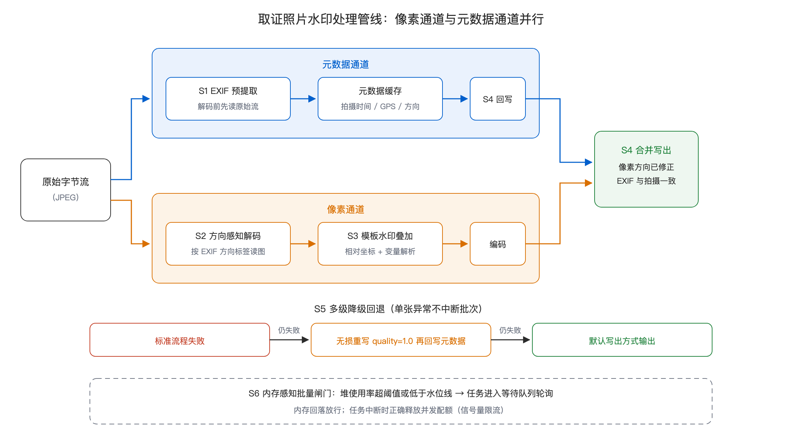

> This is an image-processing pipeline note, scoped to server-side batch watermarking of field evidence photos. Method names and step numbers correspond to a working implementation; organization, customer, and deployment details are omitted. The subject is preserving metadata and orientation and keeping batches reliable, not the business rules of watermark content or delivery workflow.

The conclusion first: **metadata preservation cannot be an "overall copy-back" after processing; it must be a second channel running through the entire pipeline.** Three judgments up front: 1) a conventional decode-draw-encode flow outputs re-encoded pixel data, and <u>EXIF metadata, a structure inside the JPEG APP1 marker segment, is not carried along with pixels automatically</u>[1][3]; 2) orientation correction must happen before watermark drawing, otherwise the watermark lands on the wrong pixel orientation and copying metadata back afterward cannot fix the misplaced content; 3) in batch processing, one image aborting the whole batch costs more than one failed image, so the fallback chain must be designed for "never interrupt," not for "throw correctly."

## 1. Two Technical Defects and Scenario Constraints

### 1. Metadata loss and orientation disorder

The evidentiary value of an evidence photo consists of the image and its capture information together: <u>EXIF tags include capture time, device model, GPS coordinates, and Orientation</u>[2]. Conventional server-side processing uses <u>ImageIO read / write for decoding and re-encoding</u>[6], leaving only pixel data in the output; once capture time and location are gone, a delivery voucher can no longer substantiate itself in a dispute.

The orientation problem arises because a portrait phone shot stores pixels in one direction while display direction is described by the EXIF Orientation tag — <u>Windows GDI+ property descriptions likewise list Orientation as a distinct orientation property</u>[4]. Generic decoding reads pixels in their stored direction; after drawing the watermark there is no EXIF to describe orientation, so the portrait output displays sideways.

| Defect | Cause | Consequence | Can copy-back fix it |
|---|---|---|---|
| Metadata loss | Re-encoding writes pixels only | Capture time, GPS, device info gone | Can restore metadata itself |
| Orientation disorder | Decode ignores Orientation; drawing on wrong orientation | Sideways image, misplaced watermark | No — watermark already drawn on wrong pixels |
| Batch abort | Single-image exception propagates | Whole watermark batch fails | No — needs chain-level fallback |

### 2. Scenario constraints

Watermarks are template-defined: text and image items in relative coordinates, with field variables in text (spot number, media name) filled from the current evidence context, so one template fits photos of different resolutions. The callers are report and delivery-package generation — batch jobs where hundreds of decoded images resident in heap at once are themselves a reliability risk. Template-driven, batch, and evidentiary: these three constraints jointly require the pipeline to solve correctness, throughput, and non-interruption at the same time.

## 2. The Four-Stage Pipeline

### 1. Metadata pre-extraction and orientation-aware decoding

S1 extracts the EXIF metadata set (capture time, orientation tag, GPS, device info) from the raw byte stream before decoding and caches it in the processing context. S2 selects the correct decoding method according to the EXIF orientation tag so that the pixel matrix in memory appears in the same direction as the shot. The order cannot be swapped: extracting after decoding risks the orientation information being consumed or discarded during decoding.

### 2. Template-driven overlay and metadata rewrite-back

S3 overlays content onto the orientation-corrected image according to the watermark template, with field variables resolved from the current evidence context. S4 merges the S1-cached metadata with the encoded pixel data on write, so the output has corrected pixel orientation and EXIF consistent with the original capture. <u>Libraries such as commons-imaging provide exactly the EXIF read/write operations needed for the merge</u>[5]. Merging happens at write time — metadata is not decoration attached at the end of processing.

Figure 1 shows the dual-channel structure: the upper metadata channel (pre-extract → cache → rewrite-back) and the lower pixel channel (orientation-aware decode → template overlay → encode) meet at the merge write.

### 3. Four stages versus common practice

| Stage | This pipeline | Common practice | Difference |
|---|---|---|---|
| Metadata acquisition | Pre-extract before decoding and cache | Copy back from source at the end | Metadata available throughout |
| Orientation | Correct at decode time from the tag | Ignore or rotate afterward | Watermark drawn on correct pixels |
| Overlay | Relative coordinates plus variable resolution | Absolute pixel coordinates | One template fits many resolutions |
| Write | Pixels and metadata merged | Re-encode pixels only | Evidence chain intact |

The four stages form an order-dependent chain: pre-extraction ensures metadata exists, orientation awareness ensures drawing is correct, template overlay ensures content is correct, and merged write ensures the artifact contains both. Reordering any stage degenerates into "an image is produced but the evidence chain has a gap."

## 3. Three-Level Fallback and the Batch Memory Gate

### 1. Progressive three-level chain

When the standard flow fails, first rewrite the JPEG at lossless quality (quality=1.0) and write metadata back; if that also fails, output via the default write path. The fallback does not throw an interrupt, so a single-image anomaly affects only that artifact's fidelity and never the rest of the batch. The goal of the three levels is not "every image perfect" but "the batch always produces output" — in evidence delivery, missing a whole batch is far worse than incomplete metadata on a few images.

| Level | Trigger | Handling | Guarantee |
|---|---|---|---|
| Standard | Normal | Complete four-stage pipeline | Correct orientation, complete metadata |
| First fallback | Standard flow fails | Lossless rewrite plus metadata write-back | Metadata preservation prioritized |
| Second fallback | First fallback fails | Default write path | At least a usable image; batch not interrupted |

### 2. Memory-aware concurrency gate

Hundreds of images decoded simultaneously during batch generation risk heap exhaustion. A semaphore caps concurrency, combined with heap watermark monitoring: <u>heap usage is read through MemoryMXBean</u>[7]; when heap usage exceeds a threshold or remaining heap falls below the watermark, tasks enter a waiting queue and poll until memory recovers, then proceed. Concurrency quotas are released correctly on interruption. The gate limits "images decoded at once," not "total tasks pending," so throughput scales elastically with available memory instead of being hard-cut by a fixed batch size.

## 4. Evidence-Chain Integrity and Boundaries

### 1. Three verifiable effects

1) Output photos retain original capture time, GPS, device, and other EXIF fields, so the voucher's evidence chain is intact; 2) portrait shots display in the correct direction with watermark position consistent with the image; 3) a single-image anomaly does not interrupt the batch, and large batches do not exhaust heap. The three map to metadata, orientation, and reliability, each verifiable against the same sample set.

### 2. Boundaries and variants

The metadata standard extends to XMP; watermark items extend to QR codes or anti-tamper hashes that bind metadata further by embedding a hash of the original pixels; the memory gate generalizes to other batch image tasks such as thumbnails and OCR preprocessing. The pipeline does not address whether photo content was tampered with — metadata preservation guarantees that original capture information is not lost through processing, not that content is authentic. That is also the distinction from anti-piracy watermarks and ID-photo watermarks: the defining features here are dual preservation of metadata and orientation in an evidentiary setting, plus a fallback pipeline for batch work.

## Closing

Treating metadata as a channel parallel to pixels is the fundamental difference from "copy back when done": orientation correction happens before drawing, metadata is merged at write time, and the two long-standing defects need no separate patches. Three-level fallback and the memory gate both address batch reliability — the former prevents a single anomaly from spreading, the latter prevents throughput from crushing the heap. The cost is one extra metadata extraction and a cached context; the return is an artifact usable directly as a delivery voucher.

## References

1. Library of Congress · Sustainability of Digital Formats: Exchangeable Image File Format (Exif) (EXIF structure and the JPEG APP1 marker segment). https://www.loc.gov/preservation/digital/formats/fdd/fdd000146.shtml
2. ExifTool · EXIF Tag Names (definitions and values for Orientation, capture time, GPS, and device tags). https://exiftool.org/TagNames/EXIF.html
3. ITU-T T.81 / ISO/IEC 10918-1 · JPEG image coding standard (APPn marker segments and re-encoded pixel data). https://www.w3.org/Graphics/JPEG/itu-t81.pdf
4. Microsoft Learn · GDI+ Property Item Descriptions (PropertyTagOrientation and other image orientation properties). https://learn.microsoft.com/en-us/windows/win32/gdiplus/-gdiplus-constant-property-item-descriptions
5. Apache Commons Imaging (EXIF metadata read/write capabilities). https://commons.apache.org/proper/commons-imaging/
6. Oracle JDK 21 API · javax.imageio.ImageIO (decode and encode flow for image read/write). https://docs.oracle.com/en/java/javase/21/docs/api/java.desktop/javax/imageio/ImageIO.html
7. Oracle JDK 21 API · java.lang.management.MemoryMXBean (heap memory usage monitoring). https://docs.oracle.com/en/java/javase/21/docs/api/java.management/java/lang/management/MemoryMXBean.html
