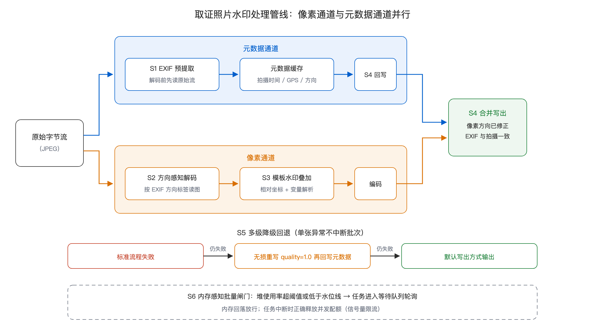

> 这是一份图像处理管线的说明，范围限定在服务端对现场取证类照片批量叠加模板化水印这一段链路。文中方法名与步骤号对应一套已落地的实现，业务主体、客户与部署信息均已略去；讨论的是元数据与方向的保全、批量的可靠性，不涉及水印内容的业务规则与交付流程。

先把结论放在前面：**元数据保全不能放在处理结束后「整体拷回」，必须作为贯穿全程的第二条通道**。三点判断放在开头：1）常规解码、绘制、编码输出的是重新编码的像素数据，<u>EXIF 元数据作为 JPEG APP1 标记段中的结构，不会随像素数据自动带出</u>[1][3]；2）方向修正必须发生在水印绘制之前，否则水印会画在错误的像素方向上，事后拷回元数据也补不回位置错乱；3）批量处理里单张图片异常中断整批，比单张处理失败本身代价更大，降级链路要按「不中断」设计，而不是按「正确抛出」设计。

## 一、两个技术缺陷与场景约束

### 1、元数据丢失与方向错乱

取证照片的证据价值由画面与拍摄信息共同构成：<u>EXIF 标签包含拍摄时间、设备型号、GPS 坐标与 Orientation 等字段</u>[2]。常规服务端图片处理用 <u>ImageIO 的 read / write 完成解码与重新编码</u>[6]，输出文件里只剩像素数据；拍摄时间与地点一旦丢失，交付凭证在争议场景下就难以自证。

方向问题的成因是手机竖拍时像素存储方向与显示方向由 EXIF Orientation 标签描述，<u>Windows 的 GDI+ 属性描述里同样把 Orientation 列为独立的方向属性</u>[4]；通用解码按像素原始方向读图，叠加水印后再无 EXIF 说明方向，竖拍成品会横向倒置显示。

| 缺陷 | 成因 | 后果 | 事后拷回能否补救 |
|---|---|---|---|
| 元数据丢失 | 重新编码只写像素数据 | 拍摄时间、GPS、设备信息缺失 | 能补元数据本身 |
| 方向错乱 | 解码忽略 Orientation，绘制在错误方向 | 画面横倒、水印位置错位 | 不能，水印已画在错误像素上 |
| 批次中断 | 单张异常向外抛出 | 整批水印任务失败 | 不能，需链路级降级 |

### 2、场景约束

水印由模板定义，模板里是相对坐标的文本项与图片项，文本内容含字段变量（点位编号、媒体名称等），需要按当前取证上下文填充；相对坐标使同一模板适配不同分辨率的照片。调用场景是报告与交付包生成，属于批量任务——数百张解码后的图像同时驻留堆内存，本身就是可靠性风险。这三个约束（模板化、批量、取证）共同决定了管线要同时解决正确性、吞吐与不中断。

## 二、四段式处理管线

### 1、元数据预提取与方向感知解码

S1 在解码图像之前，先从原始字节流中提取 EXIF 元数据集（拍摄时间、方向标签、GPS、设备信息），缓存于处理上下文；S2 按 EXIF 方向标签选择正确的解码方式，使像素矩阵在内存中呈现为与拍摄方向一致的显示方向。两步的次序不能交换：先解码再提取，方向信息可能已在解码过程中被消费或丢弃。

### 2、模板化叠加与元数据回写

S3 依据水印模板在已修正方向的图像上叠加内容，字段变量经变量解析器按当前取证上下文填充；S4 把 S1 缓存的元数据与编码后的像素数据合并写出，输出图像的像素方向已修正、EXIF 与原始拍摄信息一致。<u>commons-imaging 这类库提供的 EXIF 读写能力正是合并写出所需的底层操作</u>[5]；合并发生在写出阶段，而不是把元数据当作装饰在处理末尾贴回去。

图 1 给出双通道结构：上通道是元数据（预提取 → 缓存 → 回写），下通道是像素（方向感知解码 → 模板叠加 → 编码），两通道在合并写出处汇合。

### 3、四段与常见做法的对照

| 环节 | 本管线 | 常见做法 | 差异点 |
|---|---|---|---|
| 元数据获取 | 解码前预提取并缓存 | 处理末尾从原文件整体拷回 | 元数据在处理全程可用 |
| 方向处理 | 解码阶段按标签修正 | 忽略或事后旋转 | 水印绘制在正确方向上 |
| 水印叠加 | 相对坐标 + 变量解析 | 绝对像素坐标 | 一套模板适配多分辨率 |
| 写出 | 像素与元数据合并写出 | 重新编码像素 | 证据链完整 |

四段是一条有次序依赖的链：预提取保证元数据存在，方向感知保证绘制正确，模板叠加保证内容正确，合并写出保证成品同时含两者。任一段顺序调换，都会退化成「能出图但证据链有缺口」的结果。

## 三、三级降级与批量内存闸门

### 1、逐级回退的三级链路

标准流程失败时，先以无损质量（quality=1.0）重写 JPEG 再回写元数据；仍失败时按默认写出方式输出结果。回退过程不抛出中断，批量任务中的单张异常只影响该张成品的保真度，不影响其余照片处理。三级的目标不是「每张都完美」，而是「整批一定产出」——取证交付场景下，缺一批成品比少数几张元数据不全严重得多。

| 级别 | 触发条件 | 处理方式 | 产出保证 |
|---|---|---|---|
| 标准 | 正常 | 四段式完整管线 | 方向正确、元数据完整 |
| 一级回退 | 标准流程失败 | 无损重写 + 回写元数据 | 元数据保全优先 |
| 二级回退 | 一级仍失败 | 默认写出方式 | 至少产出可用图片，不中断批次 |

### 2、内存感知的并发闸门

批量生成时数百张图像同时解码存在堆内存溢出风险。处理系统以信号量限流并发数，并结合堆水位监测：<u>通过 MemoryMXBean 读取堆内存使用情况</u>[7]，堆使用率超阈值或剩余堆低于水位线时，任务进入等待队列轮询，内存回落后放行；任务中断时正确释放并发配额。闸门卡的是「同时解码的张数」，不是「待处理的总数」，因此吞吐随可用内存弹性变化，而不是靠固定批次大小硬切。

## 四、证据链完整性与方案边界

### 1、三条可验证的技术效果

1）输出照片保留原始拍摄时间、GPS、设备等 EXIF 信息，凭证的证据链完整；2）竖拍照片方向正确，水印位置与画面一致；3）批量处理中单张异常不中断整批，大批量场景无内存溢出。三条效果分别对应元数据、方向、可靠性，都可以用同一组样本照片逐项验证。

### 2、边界与变体

元数据标准可扩展至 XMP；水印项可扩展二维码或防伪哈希，把原始像素哈希写入水印以进一步绑定元数据；内存闸门可推广到其他批量图像任务（缩略图生成、OCR 预处理）。方案不解决照片内容是否被篡改的问题——元数据保全保证「原始拍摄信息不因处理而丢失」，不提供内容真实性证明；与图片防盗水印、证件照水印类方法的区分也在这里：本方法的特征是取证场景下的元数据与方向双保全，以及批量处理的降级管线。

## 收束

把元数据当作一条与像素并行的通道，是这套管线与「处理完再拷回」最根本的区别：方向修正在绘制之前发生，元数据在写出阶段合并，两个曾经常被引用的缺陷因此不需要各自打补丁。三级降级与内存闸门解决的都是批量场景的可靠性——前者保证单张异常不扩散，后者保证吞吐不压垮堆。代价是多一次元数据提取与一份上下文缓存，换来的是成品可直接作为交付凭证。

## 参考文献

1. Library of Congress · Sustainability of Digital Formats: Exchangeable Image File Format (Exif)（EXIF 元数据结构与 JPEG APP1 标记段）. https://www.loc.gov/preservation/digital/formats/fdd/fdd000146.shtml
2. ExifTool · EXIF Tag Names（Orientation、拍摄时间、GPS 与设备信息等标签的取值定义）. https://exiftool.org/TagNames/EXIF.html
3. ITU-T T.81 / ISO/IEC 10918-1 · JPEG 图像编码标准（APPn 标记段与重新编码的像素数据）. https://www.w3.org/Graphics/JPEG/itu-t81.pdf
4. Microsoft Learn · GDI+ Property Item Descriptions（PropertyTagOrientation 等图像方向属性）. https://learn.microsoft.com/en-us/windows/win32/gdiplus/-gdiplus-constant-property-item-descriptions
5. Apache Commons Imaging（EXIF 元数据读写能力）. https://commons.apache.org/proper/commons-imaging/
6. Oracle JDK 21 API · javax.imageio.ImageIO（图像读写的解码与编码流程）. https://docs.oracle.com/en/java/javase/21/docs/api/java.desktop/javax/imageio/ImageIO.html
7. Oracle JDK 21 API · java.lang.management.MemoryMXBean（堆内存使用率监测）. https://docs.oracle.com/en/java/javase/21/docs/api/java.management/java/lang/management/MemoryMXBean.html
