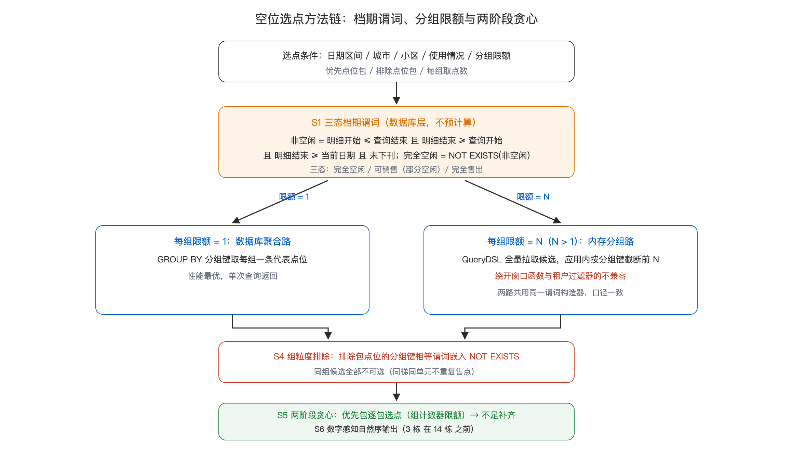

> This is a retrieval-method note, scoped to selecting outdoor-advertising spots against a delivery date range. Method names and step numbers correspond to a working implementation; organization, customer, and deployment details are omitted. The subject is query semantics and execution strategy, not pricing, contracts, or scheduling rules.

The conclusion first: **generic paginated queries cannot express the semantics of spot selection; what is needed is a method chain of predicates, grouping, and packet-level strategy.** Three judgments up front: 1) availability is an anti-existence judgment over intervals, not a status-field filter, and it can be done entirely in database predicates without precomputing occupancy tables; 2) a group quota of 1 and a quota of N are two different execution paths, switched because window functions are incompatible with ORM tenant filters; 3) excluding spot packets must propagate at group granularity, since per-spot exclusion leaves the business gap of selling twice in the same elevator or unit.

## 1. Four Business Semantics and One Implementation Constraint

### 1. Schedule semantics and physical grouping semantics

Whether a spot is free depends on whether any delivery detail overlaps the requested interval and has not been taken down. <u>Allen's 1983 interval algebra reduces relations between two time intervals to 13 basic cases, of which overlap is one — not an equality condition</u>[1]. In query terms this is an anti-existence subquery: <u>PostgreSQL's definition of EXISTS / NOT EXISTS ignores the concrete rows returned and judges only existence</u>[3]. A status field cannot express "free for the entire interval," while manual per-spot schedule checking is slow and error-prone.

Physically, spots are organized through community, floor, unit, elevator, and position, and the business requires "at most N per group" so that selected spots do not cluster in one elevator or one unit. That is a per-group cardinality constraint, not something global pagination can express.

### 2. Resource-combination semantics and the implementation constraint

A spot packet is a plan-level resource set. Selection must support including some packets preferentially and excluding others, and exclusion applies to groups rather than individual spots: once one spot in an elevator is sold, the whole elevator should be excluded. The constraint comes from the data layer. With ORM tenant filters automatically appending tenant conditions, <u>the MySQL window-function form `ROW_NUMBER() OVER(PARTITION BY ...)` for top-N per group</u>[2] is incompatible with the filter and cannot serve as the general execution path; <u>Hibernate filters act on entity queries</u>[4], so any native SQL bypassing the query layer has to reimplement tenant isolation.

| Semantic category | Business requirement | Generic pagination | Step |
|---|---|---|---|
| Schedule | Free for the whole interval | Cannot express interval anti-existence | S1 three-state predicate |
| Physical grouping | At most N per five-level group | Global paging, no per-group quota | S2 progressive group key |
| Resource combination | Packet priority, group-granularity exclusion | No packet or group concepts | S4 / S5 |
| Implementation | Compatibility with tenant filter | Native SQL bypassing the query layer loses isolation | S3 dual execution |

All four must hold within a single retrieval, otherwise the result cannot feed directly into a plan or a quote. Single-pass retrieval is therefore a design goal, not an optimization.

## 2. Three-State Predicate and Five-Level Progressive Group Key

### 1. Anti-existence predicate and derived states

For each candidate spot, construct a Boolean predicate: the spot is not free if a delivery detail exists with detail start ≤ query end and detail end ≥ query start and detail end ≥ current date and not taken down. "Completely free" is expressed as NOT EXISTS; flipping the existence direction derives "sellable (partially free)" and "fully sold," selectable by the caller through a usage-status enum. All judgments happen in database predicates — no precomputed occupancy table, no pulling the full candidate set into memory just to filter it.

| Usage state | Predicate direction | Meaning | Caller scenario |
|---|---|---|---|
| Completely free | NOT EXISTS(non-free detail) | Whole interval available | Default for new delivery plans |
| Sellable (partially free) | EXISTS(partially available interval) | Schedule is splittable | Supplemental selection, renewal review |
| Fully sold | EXISTS(full interval occupied) | Whole interval taken | Inventory review and conflict checking |

A second schedule validation before submission is necessary because another plan may occupy a spot between retrieval and commit. It shares the same predicate and does not create a second semantic source.

### 2. Progressive group key

A group key is built from community → floor → unit → elevator → position, and a caller-supplied `maxGroupByChoice` enforces "at most N spots in one physical group." The progressive key is truncatable: when the caller specifies grouping down to unit, the key stops at unit and the quota applies at that granularity; when specified down to elevator, the key extends. One key builder serves grouping quotas, group-granularity exclusion, and result ordering, so all three agree on what "same group" means.

Figure 1 shows the full chain: after condition parsing, the three-state predicate is built, execution splits on whether the per-group quota is 1, and the paths rejoin for group-granularity exclusion, two-phase greedy selection, and natural-order output.

## 3. Dual Execution, Group-Granularity Exclusion, and Two-Phase Greedy Selection

### 1. Dual execution split on the per-group quota

| Execution path | Trigger | Method | Trade-off |
|---|---|---|---|
| Database aggregation | Quota = 1 | Push grouped selection down to a `GROUP BY` aggregate returning one representative per group | Best performance, single query |
| In-memory grouping | Quota = N (N > 1) | Type-safe query builder fetches all candidates; application truncates to top N per group key | Compatible with tenant filter; avoids window functions |

Both paths share one predicate builder, so schedule judgment and group-key definition are identical and switching paths does not change result semantics. As candidate volume grows, the in-memory path degrades to segmented fetches; that is a different embodiment of the same method, not a change to the "quota == 1" split.

### 2. Group-granularity exclusion

Excluding packets never iterates spots one by one. Instead it propagates at group granularity: build progressive equality predicates equal to the group keys of spots inside excluded packets and embed them in a NOT EXISTS subquery, so every candidate in the same group as any excluded spot becomes ineligible. Per-spot exclusion removes only the listed spots; unlisted spots in the same group remain selectable, which in business terms puts sold and available spots side by side in one elevator. Group-granularity exclusion closes that gap at the result level.

### 3. Two-phase greedy selection for priority packets

Phase one runs global selection packet by packet in priority order: within each group, spots from the current packet are preferred, and a group-level counter `groupSelectedCount` tracks the quota to prevent over-selection. If the total after phase one falls short of demand, phase two tops up from remaining candidates. The difference is global rather than per-group local priority: local priority picks a few priority-packet spots inside every group, fragmenting the packet and scattering the remaining slots; global priority consumes priority packets as completely as possible first, then tops up in one pass — output much closer to the business notion of a plan-level resource set.

## 4. Sorting Consistency and Reproducibility

### 1. Digit-aware natural order

When results are sorted by group key, the comparator scans character by character and extracts consecutive digit runs as long integers for numeric comparison, so "building 3" precedes "building 14." <u>The Unicode Collation Algorithm governs ordering of character sequences</u>[5], where digit runs still compare character by character — exactly the source of Chinese building-number disorder. The client uses the same algorithm so front end and back end show identical order.

### 2. Three verifiable effects

1) One query returns a spot set satisfying both schedule and distribution policy, replacing manual per-spot checking; 2) both execution paths coexist with multi-tenant isolation and switching does not change semantics; 3) identical inputs (date range, grouping configuration, priority and exclusion packet sets) produce deterministic output that, with natural order, can feed plans and quotes directly. The three map to efficiency, isolation, and reproducibility.

### 3. Boundaries and variants

Grouping dimensions are configurable (business district, media type); the predicate extends to "partially free and splittable schedule" retrieval; the in-memory path degrades to segmented fetches above a candidate threshold. One distinction matters relative to e-commerce inventory locking or meeting-room conflict detection: interval overlap judgment itself is generic, and what distinguishes this method is the combined semantics of three-state scheduling, five-level grouped quotas, packet priority and group-granularity exclusion, plus the dual execution strategy designed around the tenant filter.

## Closing

The difficulty of spot selection lies not in writing one SQL statement but in making four semantics hold simultaneously: anti-existence over intervals, quotas over a five-level progressive key, packet policy at group granularity, and execution compatible with tenant isolation. Splitting the predicate builder, group key, and two-phase greedy step into reusable segments, then routing to two execution paths on "quota == 1," yields not a query optimization but a reproducible selection method. The cost is segmented fetching and quota truncation on the in-memory path; the return is complete semantics with isolation intact.

## References

1. Allen, J. F. (1983) Maintaining Knowledge about Temporal Intervals (13 basic relations between intervals and overlap judgment). https://cse.unl.edu/~choueiry/Documents/Allen-CACM1983.pdf
2. MySQL 8.0 Reference Manual · Window Functions (`ROW_NUMBER() OVER(PARTITION BY ...)` top-N-per-group form and limits). https://dev.mysql.com/doc/refman/8.0/en/window-functions.html
3. PostgreSQL Documentation · Subquery Expressions (EXISTS / NOT EXISTS anti-existence semantics). https://www.postgresql.org/docs/current/functions-subquery.html
4. Hibernate ORM 6.6 User Guide (`@Filter` appending conditions on entity queries). https://docs.jboss.org/hibernate/orm/6.6/userguide/html_single/Hibernate_User_Guide.html
5. Unicode Technical Standard #10 · Unicode Collation Algorithm (character-sequence collation rules and ordering semantics). https://www.unicode.org/reports/tr10/
