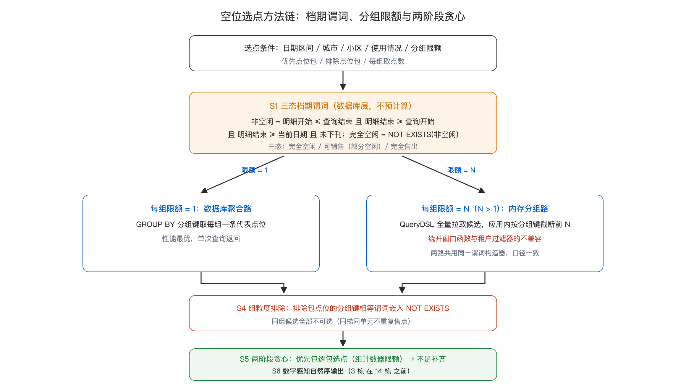

> 这是一份检索方法的说明，范围限定在户外媒体点位按投放档期选点这一段链路。文中方法名与步骤号对应一套已落地的实现，业务主体、客户与部署信息均已略去；讨论的是查询语义与执行策略，不涉及报价、合同与排期规则。

先把结论放在前面：**通用分页查询表达不了空位选点的业务语义，需要的是一条由谓词、分组、包级策略三部分串成的方法链**。三点判断放在开头：1）档期空闲是「区间反存在」判定，不是状态字段过滤，且不预计算占用表也能在数据库谓词层完成；2）分组限额为 1 与为 N 是两条不同的执行路径，切换的依据是窗口函数与 ORM 租户过滤器不兼容这一实现约束；3）排除点位包必须按组粒度扩散，逐点排除会留下「同梯同单元重复售点」的业务缺口。

## 一、四类业务语义与一条实现约束

### 1、档期语义与物理分组语义

点位是否空闲，取决于「是否存在与投放区间重叠且未下刊的投放明细」。<u>Allen 在 1983 年给出的区间代数把两个时间区间的关系归纳为 13 种，重叠是其中的一类而非一个等值条件</u>[1]；落到查询上，需要的是反存在子查询（NOT EXISTS），<u>PostgreSQL 文档对 EXISTS / NOT EXISTS 的语义定义正是不关心子查询返回的具体行、只判定是否存在</u>[3]。用状态字段过滤无法表达「整段区间全程空闲」，人工逐点核对档期则效率低且易漏。

物理上点位按小区、楼层、单元、电梯、位置逐级组织，业务要求「每个分组最多取 N 个」，避免选出的点位集中在同一部电梯或同一单元。这是分组内的数量约束，不是全局分页能表达的语义。

### 2、资源组合语义与实现约束

点位包是方案级的资源集合，选点要支持「优先包含某些包、排除另一些包」。排除的粒度是组而不是单个点位：同一电梯内一个点已售，整梯都不应再选。实现约束来自数据层：在 ORM 租户过滤器自动追加租户条件的前提下，<u>MySQL 窗口函数 `ROW_NUMBER() OVER(PARTITION BY ...)` 的分组取前 N 写法</u>[2]与该过滤器不兼容，无法直接作为通用执行路径；<u>Hibernate 的过滤器作用于实体查询</u>[4]，任何绕开查询层的原生 SQL 都要重新处理租户隔离。

| 语义类别 | 业务要求 | 通用分页查询的表达能力 | 本文对应步骤 |
|---|---|---|---|
| 档期 | 整段区间完全空闲 | 无法表达区间反存在 | S1 三态谓词 |
| 物理分组 | 五级分组内最多选 N 个 | 全局分页，无组内限额 | S2 递进分组键 |
| 资源组合 | 包优先、组粒度排除 | 无包级与组级概念 | S4 / S5 |
| 实现约束 | 窗口函数与租户过滤器兼容 | 绕开查询层的原生 SQL 会丢隔离 | S3 双路执行 |

四类语义必须落在同一次检索里，否则结果不能直接用于方案与报价；这也是「单次检索」成为设计目标而非优化目标的原因。

## 二、三态档期谓词与五级递进分组键

### 1、反存在谓词与三态派生

对每个候选点位构造布尔谓词：存在投放明细满足「明细开始日 ≤ 查询结束日 且 明细结束日 ≥ 查询开始日 且 明细结束日 ≥ 当前日期 且 未下刊」时，点位非空闲。以 NOT EXISTS 表达「完全空闲」；改变存在性方向，可以派生「可销售（部分空闲）」与「完全售出」两态，调用方按使用情况枚举选择其一。全部判定在数据库谓词层完成，不预计算占用表，也不把候选点位整批拉进内存再过滤。

| 使用状态 | 谓词方向 | 含义 | 调用场景 |
|---|---|---|---|
| 完全空闲 | NOT EXISTS(非空闲明细) | 整段档期可用 | 新建投放方案的默认条件 |
| 可销售（部分空闲） | EXISTS(部分区间可用) | 档期可拆分 | 补充选点、续投排查 |
| 完全售出 | EXISTS(全区间占用) | 整段被占 | 资源盘点与冲突核对 |

提交前对选中点位再做一次档期校验，是防止两次操作之间档期被其他方案占用的必要步骤，与检索谓词共用同一套判定，不另立口径。

### 2、递进式分组键

按小区 → 楼层 → 单元 → 电梯 → 位置五级字段构造分组键，并接受调用方给定的每组限额 `maxGroupByChoice`，约束「同一物理分组内最多选中 N 个点位」。递进式键的意义在于层级可裁剪：调用方指定到单元级时，键就截到单元，限额作用于该粒度；指定到电梯级时，键延伸到电梯。同一份键构造器同时服务于分组限额、组粒度排除与结果排序，保证三处对「同组」的定义完全一致。

图 1 给出方法链全貌：条件解析后先构造三态档期谓词，再按每组限额是否为 1 分到两条执行路径，汇合后依次执行组粒度排除、两阶段贪心与自然序输出。

## 三、双路执行、组粒度排除与两阶段贪心

### 1、以每组限额为分界的双路执行

| 执行路径 | 触发条件 | 做法 | 取舍 |
|---|---|---|---|
| 数据库聚合路 | 每组限额 = 1 | 分组取点下沉为 `GROUP BY` 聚合查询，每组返回一条代表点位 | 性能最优，单次查询返回 |
| 应用内存分组路 | 每组限额 = N（N > 1） | 类型安全的查询构造全量拉取候选，应用内按分组键截断前 N | 兼容租户过滤器，绕开窗口函数 |

两路共用同一谓词构造器，档期判定与分组键定义完全一致，切换执行路径不改变结果口径。内存路径在候选量增长时需按分段拉取退化处理，但那是同一方法的不同实施方式，不改变「以限额是否为 1 为分界」这个结构。

### 2、组粒度排除

排除点位包不按点位逐一排除，而是按组粒度扩散：构造与排除包内点位分组键相等的递进式相等谓词，嵌入 NOT EXISTS 子查询，使「与排除包内任一点位同组」的候选全部不可选。逐点排除只排除包内列出的那些点位，同组未列出的点位仍会被选中，落到业务上就是同一电梯里出现两个已售与待售并存的组合；组粒度排除把这条缺口从结果层堵住。

### 3、优先包两阶段贪心

第一阶段按优先点位包顺序逐包执行全局选点：在每个分组内优先取用当前包内点位，并以组级计数器 `groupSelectedCount` 跟踪限额防止超组；第一阶段结束后若总数不足需求数，第二阶段从剩余候选点补充至满足需求。两阶段的差别在于「全局优先」而非「分组局部优先」：后者会在每个分组里各自挑一点高优先包点位，结果是高优先包被切碎、剩余名额散落各组；前者先尽可能完整吃掉高优先包，再统一补齐，输出更接近业务上「方案级资源集合」的语义。

## 四、排序一致性与结果可复现

### 1、数字感知自然序

分组结果按分组键排序时，比较器逐字符扫描，把连续数字段提取为长整型按数值比较，使「3 栋」排在「14 栋」之前。<u>Unicode 排序算法 UCA 处理的是字符序列的整理规则</u>[5]，字典序下数字段仍按字符逐个比较，这正是中文楼栋序错乱的来源；客户端采用同款算法，保证前后端看到的顺序一致。

### 2、三条可验证的技术效果

1）单次查询即返回满足档期与分布策略的点位集合，替代人工逐点核对；2）两条执行路径都与多租户隔离机制共存，切换不改变口径；3）同一输入（日期区间、分组配置、包优先与排除集合）产生确定性输出，配合自然序，结果可直接用于方案与报价。三条效果分别对应效率、隔离与可复现。

### 3、边界与变体

分组维度可配置化扩展（如增加商圈、媒体类型）；谓词可扩展「部分空闲且可拆分档期」的检索形态；内存分组路径在候选量超阈值时可退化为分段拉取。需要注意与电商库存锁定、会议室预订冲突检测类方法的区分：区间重叠判定本身是通用技术，本方法的区分特征在于「档期三态 + 五级分组限额 + 包级优先与组粒度排除」这一整套组合语义，以及为兼容租户过滤器而设计的双路执行策略。

## 收束

空位选点的难点不在单条 SQL 的写法，而在四类业务语义必须同时成立：档期要按区间反存在判定，分组要按五级递进键限额，包级策略要落在组粒度，执行又要与租户过滤器共存。把谓词构造器、分组键与两阶段贪心拆成可复用的三段，再以「每组限额是否为 1」分流到两条执行路径，得到的不是一次查询优化，而是一套结果可复现的选点方法。代价是内存分组路径需要分段拉取与限额裁剪，换来的是语义完整与隔离兼容。

## 参考文献

1. Allen, J. F. (1983) Maintaining Knowledge about Temporal Intervals（时间区间的 13 种基本关系与重叠判定）. https://cse.unl.edu/~choueiry/Documents/Allen-CACM1983.pdf
2. MySQL 8.0 Reference Manual · Window Functions（`ROW_NUMBER() OVER(PARTITION BY ...)` 分组取前 N 的写法与限制）. https://dev.mysql.com/doc/refman/8.0/en/window-functions.html
3. PostgreSQL Documentation · Subquery Expressions（EXISTS / NOT EXISTS 的反存在子查询语义）. https://www.postgresql.org/docs/current/functions-subquery.html
4. Hibernate ORM 6.6 User Guide（`@Filter` 在实体查询上自动追加条件）. https://docs.jboss.org/hibernate/orm/6.6/userguide/html_single/Hibernate_User_Guide.html
5. Unicode Technical Standard #10 · Unicode Collation Algorithm（字符序列整理规则与排序口径）. https://www.unicode.org/reports/tr10/
