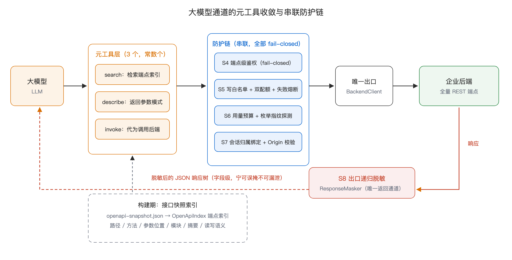

> This is a channel design note, scoped to the segment where a server-side enterprise system opens business capabilities to a large language model: how tools are organized, how calls are authorized, and how responses leave the channel. Prompt strategy on the model side and human confirmation in the orchestration layer are out of scope. Component names and step numbers correspond to a working implementation; organization, customer, and deployment details are omitted.

The conclusion first: **connecting enterprise APIs to an LLM is not a problem of translating endpoints into tools; it is two problems — decoupling tool count from endpoint count, and preventing privilege amplification when the backend runs under a high-privilege service account.** The first is answered by a build-time snapshot index plus three meta-tools; the second by a chained defense line that fails closed at every layer. Both share a single call path with one exit point and centralized masking. Three judgments up front: 1) registering one tool per endpoint makes tool-definition context grow linearly with endpoint count while selection accuracy degrades with candidate count; 2) natural-language-to-SQL bypasses application-layer authorization and tenant isolation, which is an architectural regression, not a shortcut; 3) budget-based guards constrain totals only and cannot see low-volume enumeration that fetches records one ID at a time, so distribution-shape detection needs its own layer.

## 1. Two Integration Routes and Four Channel-Specific Attack Surfaces

### 1. Structural defects of per-endpoint registration and natural-language SQL

Registering each REST endpoint as one LLM tool is the most intuitive route. <u>The MCP specification exposes tools through `tools/list`, and the model selects a tool by name and input schema</u>[1]. With a one-to-one mapping, endpoint count directly determines candidate tool count, and every new endpoint requires synchronized registration and description maintenance. <u>OpenAPI 3.1 describes endpoints through Paths, Operations, and Parameter Objects, with parameter locations path, query, header, and cookie</u>[2]. That document is written for developers; converting it wholesale into tool definitions simply compresses the developer view into model context.

Letting the model generate SQL against the database is worse: application-layer authorization, tenant isolation, query semantics, and auditing are all bypassed. Even object-level authorization is insufficient — <u>OWASP classifies leakage of sensitive object properties after object-level checks pass as API3:2023 Broken Object Property Level Authorization</u>[3]. Model-generated SQL has no object-level check at all, so the risk changes in kind, not in degree.

### 2. Four attack surfaces absent from conventional API gateways

The difference from ordinary API calls is that the caller is a model rather than deterministic code. <u>The OWASP GenAI risk list names prompt injection and excessive agency as core entries</u>[4]: the model can be induced to call tools it should not call, or to call them in abnormal patterns.

| Attack surface | Cause | Consequence | Gate |
|---|---|---|---|
| Privilege amplification | Backend proxies calls under a high-privilege service account without endpoint-level checks | A low-privilege session reaches unauthorized endpoints | S4 endpoint authorization |
| Write probing | Model is induced to retry write operations | Validation rules are probed; dirty writes land | S5 write control |
| Enumerative exfiltration | Low-volume, precisely parameterized per-record fetches | Data is extracted in full while total budget stays under limit | S6 enumeration detection |
| Session takeover and field leakage | Session identifiers leak; responses are returned as-is | Replayed calls; sensitive fields leave with output | S7 session binding / S8 exit masking |

The four are independent. No single point of protection covers all of them, which is why the defenses must be serialized on one channel instead of scattered across business endpoints.

### 3. Evaluation criteria

Three criteria: 1) tool-definition size is independent of endpoint count; 2) every call's authorization verdict derives from the caller identity, not the service account identity; 3) all responses pass one exit with centralized, auditable field-level masking.

## 2. Snapshot Index and Meta-Tool Convergence

### 1. Build-time index and read/write semantic classification

<u>OpenAPI 3.1 Operation Objects carry path, method, parameter schemas, and a summary</u>[2]. Consuming a snapshot file at build time yields a searchable endpoint index; runtime no longer depends on document generation.

| Index field | Source | Purpose |
|---|---|---|
| Path and HTTP method | Paths / Operations | Endpoint identity and proxy-call target |
| Parameter schema (including `in`) | Parameter Object | Automatic argument assembly in invoke |
| Module ownership | Tags or path convention | Endpoint-level permission mapping |
| Summary | Operation description | Keyword search and model selection |
| Read / write semantic flag | Path and summary semantics | Admission basis for write control |

The read/write flag must not be derived from the HTTP verb. Many business systems use `POST /xxx/list` for queries; verb-based classification would mislabel every list query as a write and disable it, making the channel unusable. Semantic classification costs one rule set and preserves full query capability.

### 2. Three meta-tools and the call chain

Exactly three meta-tools are exposed, so tool count drops from linear in endpoints to constant. The model uses any endpoint through search → describe → invoke; adding an endpoint only refreshes the snapshot index.

| Meta-tool | Input | Output | Constraint |
|---|---|---|---|
| search | Keywords | Candidate endpoint IDs and summaries | No execution |
| describe | Endpoint ID | Parameter schema, locations, description | Model assembles arguments from it |
| invoke | Endpoint ID and arguments | Backend response (masked at exit) | Only entry with side effects |

Figure 1 shows the overall structure: the request chain (model → meta-tool layer → defense chain → single exit → enterprise backend), the return chain (backend response → recursive exit masking → model), and the build-time snapshot index supporting the meta-tool layer.

### 3. Argument normalization and alias mapping

On invoke, arguments are assembled into path, query, or body according to the declared locations, so the model need not understand binding mechanics. Chinese API documentation often names parameters differently from actual binding names (for example, "page number" versus `page`); an alias table normalizes them before dispatch, eliminating a whole class of naming-only call failures. Dispatch assembles arguments and performs no business validation, avoiding a second copy of business rules inside the channel.

## 3. Six Gates on the Chained Defense Line

### 1. Endpoint authorization and write control

S4 maintains a module → permission-code map and checks the caller's permission against the endpoint's module on every invoke; missing mappings or check failures are rejected, that is, fail-closed. This gate targets high-privilege service-account deployments specifically: the backend account's privileges are not the session's privileges, and the verdict must come from the session identity.

S5 maintains a write-endpoint whitelist, applies session-level and tenant-level daily dual quotas to allowed writes, and trips a circuit breaker on consecutive write failures. The breaker addresses the path where a model is induced to retry writes in order to probe validation rules — a different dimension from quota totals.

### 2. Dual-dimension budget and enumeration detection

S6 applies a sliding window to a dual budget of call count and response bytes. On top of it, enumeration detection tracks the set of distinct argument fingerprints per (tenant, user, endpoint) key; when the distinct count for one endpoint exceeds a threshold, the call is classified as enumerative bulk extraction and fused, with a structured alert carrying the distinct count and threshold. The fingerprint dimension matters because an attacker who stays under the total budget while fetching one ID at a time shows no anomaly in call count or bytes — the only anomaly is the distribution shape of arguments. Totals and shape cannot substitute for each other.

### 3. Session binding and channel hardening

S7 binds session identifiers to login identities and rejects requests from non-owning sessions, so a session ID leaked through logs cannot be replayed. An Origin allowlist is enforced at the entry point; <u>RFC 6454 defines the Origin header and same-origin determination, the basis for defending against DNS-rebinding-style source forgery</u>[5]. Client-supplied tenant identifiers are cross-checked, never trusted directly. Request-level identity rides on the <u>Authorization: Bearer header</u>[6], not on a server-side session mapping table, so permission changes take effect on the next request.

| Gate | Verdict basis | Failure behavior | Attack surface |
|---|---|---|---|
| S4 endpoint authorization | Session identity vs endpoint module permission | Reject (including missing mapping) | Privilege amplification |
| S5 write control | Whitelist + dual quotas + consecutive failure count | Reject or fuse | Write probing, dirty writes |
| S6 usage and enumeration | Count/byte budget + distinct argument fingerprints | Fuse and alert | Enumerative exfiltration |
| S7 session and origin | Session ownership, Origin allowlist, tenant cross-check | Reject | Session takeover, forged requests |
| S8 exit masking | Recursive field-name match on response tree | Mask on hit | Field-level leakage |

## 4. Recursive Exit Masking and Boundaries

### 1. Single exit and field-level masking

All responses return through one exit component that recursively masks the JSON response tree by field name, covering five categories — phone numbers, bank cards, identity documents, email addresses, and secrets — including case and camel-case variants. When a field name matches but the value shape does not (too short, wrong format), the whole value is masked: over-masking is acceptable, leakage is not. <u>OWASP API3:2023 recommends authorizing and filtering returned object properties individually</u>[3]; doing it once at a single exit is far more auditable than doing it in every endpoint.

| Field category | Detection | Masking policy | Shape mismatch |
|---|---|---|---|
| Phone number | Field name and variants | Keep prefix and suffix, mask middle | Full mask |
| Bank card / ID | Field name and variants | Keep last few digits | Full mask |
| Email | Field name and variants | Keep domain, mask local part | Full mask |
| Secrets | Field name and variants | Full mask | Full mask |

### 2. Three verifiable effects

1) Tool-definition context drops from linear growth to constant while endpoint coverage expands to the full set; 2) the authorization verdict is decoupled from deployment topology, so a high-privilege service account no longer implies a high-privilege caller; 3) enumerative exfiltration under the total budget is caught by fingerprint detection, and field-level leakage is blocked at the single exit. All three can be verified without changing business endpoints.

### 3. Boundaries and variants

The description source need not be an OpenAPI snapshot; GraphQL introspection and gRPC reflection are equivalent substitutes. Meta-tools can be grouped by business domain — the constant-size property holds as long as each group's size is independent of endpoint count. Fingerprints can be enriched with statistical features such as argument-value entropy, which improves detection without changing the two-dimensional structure of totals plus shape. The design does not solve prompt injection itself; injection consequences are narrowed layer by layer on this channel, and the boundary between the two problems should stay explicit.

## Closing

Meta-tool convergence solves a scale problem; the chained defense line solves a trust problem. The critical design in the former is classifying read/write semantics from path and summary rather than HTTP verb, and the most important layer in the latter is enumeration detection, which closes the gap left by budget guards that watch totals but not distribution shape. Routing every response through one exit turns field-level masking from "written once per endpoint" into "one policy, one execution." The cost is one more index to maintain and one channel hop; the return is tool count decoupled from endpoint count and security policy centralized and auditable.

## References

1. Model Context Protocol specification 2025-11-25 (`tools/list` discovery, tool names and inputSchema, JSON-RPC 2.0 messages). https://modelcontextprotocol.io/specification/2025-11-25
2. OpenAPI Specification 3.1.0 (Paths / Operations / Parameter Objects and `in: path/query/header/cookie`). https://spec.openapis.org/oas/v3.1.0.html
3. OWASP API Security Top 10 2023 · API3:2023 Broken Object Property Level Authorization (property-level leakage after object-level checks pass). https://owasp.org/API-Security/editions/2023/en/0xa3-broken-object-property-level-authorization/
4. OWASP GenAI Security Project · OWASP Top 10 for LLM Applications (prompt injection and excessive agency). https://genai.owasp.org/llm-top-10/
5. RFC 6454 · The Web Origin Concept (Origin header, same-origin determination, source validation). https://datatracker.ietf.org/doc/html/rfc6454
6. RFC 6750 · The OAuth 2.0 Authorization Framework: Bearer Token Usage (request-level identity in the Authorization header). https://datatracker.ietf.org/doc/html/rfc6750
