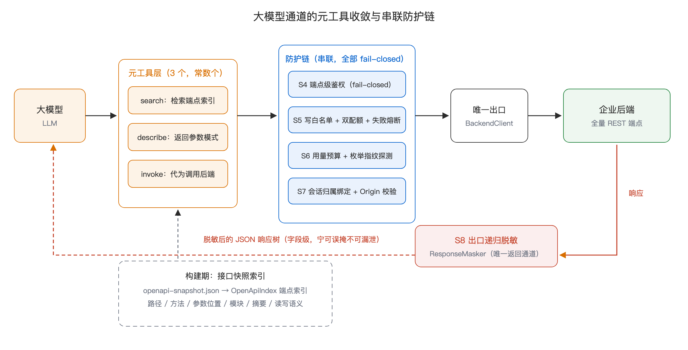

> 这是一份通道设计的说明，范围限定在企业系统服务端向大模型开放业务能力这一段链路：工具如何组织、调用如何鉴权、响应如何出关。模型侧的提示词策略、编排层的人机确认不在本文范围内。文中组件名与步骤号对应一套已落地的实现，业务主体、客户与部署信息均已略去。

先把结论放在前面：**企业接口接入大模型，要解决的不是「怎么把接口翻译成工具」，而是「工具数量与端点规模解耦」和「服务账号高权限形态下不产生权限放大」这两件事**。前者的答案是构建期快照索引加三个元工具，后者的答案是一条全部 fail-closed 的串联防护链；两者共用一次调用，出口唯一，脱敏集中。三点判断放在开头：1）按端点逐个注册工具，工具定义占用的上下文随端点数线性增长，模型选择准确率随候选数量下降；2）自然语言转 SQL 绕过应用层权限与租户隔离，属于不可接受的架构退让；3）预算类防护只约束总量，识别不了「逐个编号精确取数」的低流量枚举，必须单独设一层分布形态检测。

## 一、两条接入路线与四个通道特有攻击面

### 1、逐端点注册与自然转 SQL 的结构性缺陷

把每个 REST 端点注册成一个大模型工具，是最直觉的做法。<u>MCP 规范里工具由 `tools/list` 提供，模型按工具名与参数模式（inputSchema）选择并调用</u>[1]，端点与工具一一对应时，端点规模直接决定候选工具规模；新增端点还要同步维护注册与描述，工程成本随业务迭代持续累积。<u>OpenAPI 3.1 用 Paths、Operations 与 Parameter Object 描述端点，参数位置分为 path、query、header、cookie</u>[2]，这份文档本来是给开发者看的，把它整体转成工具定义，等于把开发者的视图原样压进模型上下文。

让模型直接生成 SQL 查库是另一条路，缺陷更硬：应用层权限、租户隔离、查询口径与审计全部被绕过，而<u>对象级授权即便通过，接口仍可能把对象里的敏感字段整段返回，OWASP 把这类问题单列为 API3:2023 对象属性级授权缺陷</u>[3]。模型生成的 SQL 连这一层对象级授权都没有，风险不是量变而是性质变化。

### 2、四个不属于传统 API 网关的攻击面

大模型通道与常规 API 调用的差别在于调用发起者是模型而非确定代码，攻击面因此多出四类，且<u>OWASP 大模型应用风险清单把提示注入与过度代理（Excessive Agency）列为核心条目</u>[4]——模型可能被诱导去调用本不该调用的工具、按异常模式反复调用。

| 攻击面 | 成因 | 后果 | 对应闸门 |
|---|---|---|---|
| 权限放大 | 后端以高权限服务账号代调，未做端点级校验 | 低权限会话借通道访问越权端点 | S4 端点级鉴权 |
| 写操作探测 | 模型被诱导反复尝试写接口 | 探测校验规则、产生脏写 | S5 写管控 |
| 枚举式外带 | 攻击者以低总量、逐条精确的参数取数 | 总预算不超标但数据被整体搬走 | S6 枚举探测 |
| 会话接管与字段泄漏 | 会话标识泄漏、响应原样返回 | 重放调用、敏感字段随输出带出 | S7 会话绑定 / S8 出口脱敏 |

四类攻击面彼此独立，任何单点防护都覆盖不全，这决定了防护必须在同一通道上串联，而不是散落在各业务接口里。

### 3、判定标准

评估通道方案的判据收敛为三条：1）工具定义规模与端点规模无关；2）每次调用的鉴权判据来自调用者身份而非服务账号身份；3）全部响应经过唯一出口，字段级脱敏策略集中且可审计。下文按这三条展开。

## 二、接口快照索引与元工具收敛

### 1、构建期快照索引与读写语义判定

<u>OpenAPI 3.1 的 Operation Object 携带路径、方法、参数模式与摘要</u>[2]，构建期消费一份快照文件即可建立可检索的端点索引，运行时不再依赖文档生成。索引字段与用途如下。

| 索引字段 | 来源 | 用途 |
|---|---|---|
| 路径与 HTTP 方法 | Paths / Operations | 端点唯一标识与代调依据 |
| 参数模式（含 in 位置） | Parameter Object | invoke 参数自动装配 |
| 模块归属 | 标签或路径约定 | 端点级权限映射 |
| 摘要 | Operation 描述 | search 的关键词检索与模型选点 |
| 读 / 写语义标记 | 路径与摘要语义判定 | 写操作管控的准入依据 |

读写标记不按 HTTP 动词判定，这一点是实施中最容易出错的地方：业务系统里大量 `POST /xxx/list` 实为查询，按动词判定会把全部列表查询误判为写操作而被禁用，通道直接不可用。语义判定的代价是要维护一份判定规则，收益是查询能力完整保留。

### 2、三个元工具及其调用链

对模型只暴露三个元工具，工具数量从与端点线性相关降为常数；模型以「先 search 再 describe 后 invoke」的链路使用任意端点，新增端点只需更新快照索引，无需改动工具注册。

| 元工具 | 输入 | 输出 | 约束 |
|---|---|---|---|
| search | 关键词 | 候选端点标识与摘要 | 只返回检索结果，不执行调用 |
| describe | 端点标识 | 参数模式、参数位置、说明 | 模型据此组装参数 |
| invoke | 端点标识与参数 | 后端响应（经出口脱敏） | 唯一产生副作用的入口 |

图 1 给出通道总体结构：上半段是请求链（模型 → 元工具层 → 防护链 → 唯一出口 → 企业后端），下半段是返回链（后端响应 → 出口递归脱敏 → 模型），左下是构建期快照索引对元工具层的支撑。

### 3、参数归一分派与别名映射

invoke 收到模型给出的参数后，按快照中声明的位置把参数装配到 path、query 或 body，模型不需要理解底层的绑定方式。中文接口文档里的参数名与真实绑定名常有差异（如「页码」对应 `page`），用一张别名映射表在分派前归一，可以消除一类纯命名导致的调用失败。分派层只做装配，不做业务校验，避免把业务规则复制到通道里形成第二套口径。

## 三、串联防护链的六道闸

### 1、端点级鉴权与写操作管控

S4 维护「模块 → 权限码」映射，每次 invoke 按端点所属模块校验调用者权限；映射缺失或校验异常一律拒绝，即 fail-closed。这条闸专门针对服务账号高权限部署形态：后端代调用的账号权限高，不代表调用它的会话权限高，鉴权判据必须取自会话身份。

S5 维护写端点白名单，对放行的写操作实施会话级与租户级日双重配额，并对连续写失败实施熔断。熔断针对的是「诱导模型反复尝试写操作以探测校验规则」这条路径，与配额控制总量的维度不同。

### 2、双维预算与枚举探测

S6 用滑动窗口对「调用次数 + 响应字节」实施双维预算，在此基础上增设一层枚举探测：以（租户, 用户, 端点）为键追踪窗口内的 distinct 参数指纹集合，当同一端点的不同参数指纹数超过阈值即判定为枚举式批量取数并熔断，同时输出结构化告警（含 distinct 参数数与阈值）。指纹维度的意义在于，攻击者把总调用量压在预算以内、逐个编号精确取数时，调用次数与响应字节都不异常，唯一异常的是参数指纹的分布形态——总预算管总量，指纹集合管形态，两者不能互相替代。

### 3、会话绑定与通道防护

S7 把会话标识与登录身份建立归属绑定，非归属会话的请求直接拒绝，防止日志里泄漏的会话 ID 被接管重放；入口实施 Origin 白名单校验，<u>RFC 6454 定义了 Origin 头与同源判定，是防御 DNS rebinding 类请求来源伪造的依据</u>[5]；客户端携带的租户标识只做交叉校验，不直接采信。请求级身份依附于 <u>Authorization: Bearer 头</u>[6]，不依赖服务端维护的会话映射表，权限变更在下一次请求即生效。

六道闸的判据与失败行为统一如下，任何一层的异常都不构成放行理由。

| 闸门 | 判据 | 失败行为 | 覆盖的攻击面 |
|---|---|---|---|
| S4 端点级鉴权 | 会话身份对端点模块的权限码 | 拒绝（含映射缺失） | 权限放大 |
| S5 写管控 | 写白名单 + 会话/租户日双配额 + 连续失败计数 | 拒绝或熔断 | 写探测、脏写 |
| S6 用量与枚举 | 次数/字节双维预算 + distinct 参数指纹数 | 熔断并告警 | 枚举式外带 |
| S7 会话与来源 | 会话归属、Origin 白名单、租户交叉校验 | 拒绝 | 会话接管、请求伪造 |
| S8 出口脱敏 | 响应树字段名递归匹配 | 命中即打码 | 字段级泄漏 |

## 四、出口递归脱敏与方案边界

### 1、唯一出口与字段级脱敏

所有响应经由唯一出口组件返回，出口对 JSON 响应树按字段名递归脱敏，覆盖手机号、银行卡、证件号、邮箱、口令五类字段名及其大小写与驼峰变体。对「命中字段名但值形态不符合」的情况（例如长度不足、格式不像），取整段打码策略：宁可误掩，不可漏泄。字段级策略之所以必须集中在出口，是因为<u>对象级权限无法覆盖对象内部的敏感属性，OWASP API3:2023 建议的做法正是按返回对象的属性逐一授权与过滤</u>[3]，在唯一出口做一次比在数百个端点各做一次更可审计。

| 字段类别 | 识别方式 | 打码策略 | 值形态不符时 |
|---|---|---|---|
| 手机号 | 字段名及变体 | 保留段首与段尾，中段打码 | 整段打码 |
| 银行卡 / 证件号 | 字段名及变体 | 保留末位若干位 | 整段打码 |
| 邮箱 | 字段名及变体 | 域名保留，本地部分打码 | 整段打码 |
| 口令类 | 字段名及变体 | 整段打码 | 整段打码 |

### 2、三条可验证的技术效果

1）工具上下文占用从随端点线性增长降为常数，覆盖的端点范围反而扩大到全量；2）鉴权判据与部署形态解耦，服务账号高权限不再等于调用者高权限；3）总预算未超标的枚举式外带可由参数指纹检测识别，字段级泄漏在唯一出口被拦截。三条效果都可以在不改变业务接口的前提下单独验证。

### 3、边界与变体

接口描述来源不限于 OpenAPI 快照，GraphQL introspection 与 gRPC 反射可等价替换；元工具可按业务域分成多组，只要每组数量与端点规模无关，常数级性质不变；枚举指纹可加入参数值分布熵等统计特征，但那属于提高检出率的改进，不改变「总量与形态双维控制」这一结构。方案不解决模型侧提示词注入本身，注入的后果由这条通道上的闸逐层收窄，两件事的边界要分清。

## 收束

元工具收敛解决的是规模问题，串联防护链解决的是信任问题。前者的关键设计是读写语义按路径与摘要判定、而非按 HTTP 动词判定，后者最关键的一层是枚举探测——它补上了预算类防护只看总量、不看分布形态的缺口。全部响应从唯一出口返回，让字段级脱敏从「每个端点各写一遍」变成「一处策略、一次执行」。这套结构的代价是多一次索引维护与一层通道开销，换来的是工具数量与端点规模解耦、安全策略集中可审计。

## 参考文献

1. Model Context Protocol 规范 2025-11-25 版（`tools/list` 工具发现、工具名与 inputSchema 定义、JSON-RPC 2.0 消息）. https://modelcontextprotocol.io/specification/2025-11-25
2. OpenAPI Specification 3.1.0（Paths / Operations / Parameter Object 的结构与参数位置 in: path/query/header/cookie）. https://spec.openapis.org/oas/v3.1.0.html
3. OWASP API Security Top 10 2023 · API3:2023 Broken Object Property Level Authorization（对象级授权通过后仍可能发生属性级敏感数据泄漏）. https://owasp.org/API-Security/editions/2023/en/0xa3-broken-object-property-level-authorization/
4. OWASP GenAI Security Project · OWASP Top 10 for LLM Applications（提示注入与过度代理风险条目）. https://genai.owasp.org/llm-top-10/
5. RFC 6454 · The Web Origin Concept（Origin 头、同源判定与来源校验）. https://datatracker.ietf.org/doc/html/rfc6454
6. RFC 6750 · The OAuth 2.0 Authorization Framework: Bearer Token Usage（Authorization: Bearer 的请求级身份载体）. https://datatracker.ietf.org/doc/html/rfc6750
