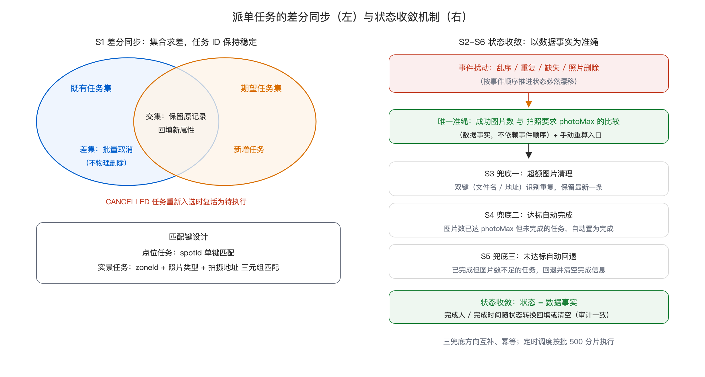

> This is a task-consistency note, scoped to spot tasks and real-scene tasks in media-delivery fieldwork. Method names and step numbers correspond to a working implementation; organization, customer, and deployment details are omitted. The subject is maintaining the task set and deciding task state, not crew scheduling or performance evaluation.

The conclusion first: **task state should be decided by data facts, not event order; the task set should be reconciled by set difference, not rebuilt wholesale on range changes.** Three judgments up front: 1) the cost of delete-and-rebuild is not performance but losing photo associations, completion progress, and assignees attached to existing tasks — no rework for field crews is a hard constraint; 2) upload success, photo deletion, and manual marking inevitably arrive out of order, duplicated, or missing in a distributed setting, and an event-driven state machine freezes those disturbances into state; 3) once successful image count versus photo requirement is the ground truth, convergence needs no event history, and three complementary scheduled fallbacks cover every direction of deviation.

## 1. Two Defects: Full Rebuild and State Drift

### 1. Full rebuild destroys business assets

When a dispatch's spot range changes, a common implementation deletes all its tasks and regenerates them. Deletion is fast; the cost lies elsewhere — photo associations, completion progress, and assignees disappear with the records, and work already done on in-progress tasks is voided. <u>Systems that advance state by event order typically record state changes as an event sequence</u>[5]; a full rebuild erases that sequence together with the entities it points to, with nothing to restore from.

### 2. Three disturbances behind state drift

| Disturbance | Trigger | Drift result | Behavior under event-order advancement |
|---|---|---|---|
| Reordering | Concurrent uploads, network reordering | Sufficient photos but state not complete | Completion event arrives before the last image event |
| Duplication | Same photo uploaded repeatedly | Excess images, inflated state | Each upload event advances state once |
| Loss | Lost events, deleted photos, rejected photos | State complete but images insufficient | No later event rolls the completed state back |

<u>Eventual consistency does not mean state becomes correct automatically; it means the system converges to a value once new input stops</u>[1], while <u>the CAP proof shows distributed settings cannot eliminate such deviations with strong-consistency transactions</u>[2]. If the convergence target is determined by event order, what converges is the wrong state. The decision basis must therefore move from events to data facts first.

### 3. Criteria

Four criteria: 1) task IDs stay stable across changes, with photo associations and progress preserved; 2) state agrees with data facts regardless of event arrival order; 3) fallback logic is idempotent — repeated execution does not change the result; 4) batch processing produces neither long transactions nor oversized SQL.

## 2. Set-Difference Differential Sync

### 1. Three branches of the difference

On a spot-range change, regenerate the expected task set from the new spot set, then compute the difference and intersection against the existing task set: intersection tasks keep their original records with new attributes backfilled; previously cancelled tasks revive to pending when re-selected; tasks in the difference are cancelled in bulk rather than physically deleted.

| Branch | Set relation | Action | Preserved |
|---|---|---|---|
| Intersection | Existing ∩ Expected | Keep original record, backfill new attributes | Task ID, photo links, progress, assignee |
| Expected-only | Expected − Existing | Create new tasks | No history; initialize from new attributes |
| Existing-only | Existing − Expected | Bulk cancel (no physical delete) | History stays auditable; reused on revival |

Cancelling instead of deleting is deliberate: physical deletion removes the anchor point for historical photos and makes "this spot was once dispatched" unauditable. Bulk cancellation keeps the record, so re-selection revives it directly from the cancelled state without creating a new task.

### 2. Dual matching keys

Differential reconciliation presupposes that the same task is recognizable before and after the change. Spot tasks match on a single key, the spot ID; real-scene tasks match on a triple of community ID, photo type, and shooting address. The triple is necessary because different photo types and addresses inside one community correspond to different tasks — a single key would wrongly merge them into one and distort the difference.

Figure 1 shows the three set branches and the revival rule on the left, and the convergence loop on the right: disturbances do not change the decision basis; data facts are the ground truth; the three fallbacks cover complementary directions.

## 3. Convergence with Data Facts as Ground Truth

### 1. Single ground truth and manual recalculation

The decision basis for task state is unified as a data fact: the comparison between the number of successfully uploaded images under a task and its photo requirement `photoMax`, rather than the order of upload, deletion, or marking events. A manual entry point recalculates state for a specified batch of tasks against that ground truth. Manual recalculation and scheduled fallbacks share the same recalculation logic, so there are never two semantics — one for manual, one for the scheduler.

### 2. Three complementary scheduled fallbacks

| Fallback | Scans | Action | Deviation direction |
|---|---|---|---|
| Excess-image cleanup | Tasks whose image count exceeds the requirement | Identify duplicate uploads by an OR of two keys (filename or image URL), keep the newest, remove the rest, then recalculate | Input-side duplication |
| Auto-complete on sufficiency | Tasks with images reaching `photoMax` but state not complete | Mark complete; completer and completion time taken from the last successful upload | Should be complete but is not |
| Auto-rollback on insufficiency | Tasks complete but with insufficient images | Roll back to incomplete and clear completer and completion time | Should not be complete but is |

The three cover every sign of deviation: cleanup governs the input side, auto-complete corrects upward, auto-rollback corrects downward. Backfilling and clearing completer and completion time are bound to state transitions, avoiding the audit inconsistency of "state rolled back but operator left behind." The fallbacks are idempotent — <u>running the same batch twice yields the same result, the same property that lets idempotent requests preserve single-effect semantics under redelivery</u>[3].

### 3. The convergence loop

Disturbances (reordering, duplication, loss, photo deletion) no longer modify state directly; they modify data facts. State is recalculated from the ground truth or approached from the three fallback directions. Manual recalculation converges immediately, scheduled jobs converge periodically, and together the system converges to "state = data facts" once new input stops. The structure needs neither event sourcing nor distributed transactions nor exactly-once event delivery.

## 4. Sharding, Idempotence, and Boundaries

### 1. Batch sharding

Fallback jobs process in batches (for example, 500 tasks each), avoiding the SQL length and performance problems of querying with long ID lists. <u>Spring Batch's chunk-oriented processing splits large volumes into repeatable small transactional units</u>[4]; the batching here follows the same idea — recalculation inside a batch is idempotent, batches are independent, and a failed batch is retried alone without affecting the others.

### 2. Three verifiable effects

1) After a spot-range change, photo links and progress on in-progress tasks are fully preserved and field crews do not redo work; 2) state converges to data facts within one fallback cycle even after reordering, duplicate uploads, and photo deletion; 3) repeated fallback runs are consistent and sharding avoids long transactions and oversized SQL. The three map to task set, state correctness, and execution reliability.

### 3. Boundaries and variants

Matching keys extend to fuzzy matching for historical tasks whose spot number changed; ground truth extends to multiple conditions (image count plus review verdict plus watermark validation); the mechanism generalizes to any isomorphic "data facts vs state" consistency scenario, such as ticket completion criteria or inventory occupation. It does not verify the authenticity of photo content, nor cover task assignment and personnel permissions — those are separate chains for evidence and authorization, outside this note's scope.

## Closing

The method separates two concerns: the task set is maintained by set difference so IDs and historical assets stay stable, and task state is decided by data facts so event order becomes irrelevant. The key to set difference is the dual matching key; the key to convergence is the complementarity of three fallbacks — implementing only "auto-complete on sufficiency" without "auto-rollback on insufficiency" leaves state permanently stuck at completed after a photo is deleted. Neither part depends on distributed transactions; idempotence and sharding keep the cost bounded.

## References

1. Vogels, W. (2008) Eventually Consistent (the meaning of eventual consistency: convergence to a value once new input stops). https://www.allthingsdistributed.com/2008/12/eventually_consistent.html
2. Gilbert, S. & Lynch, N. (2002) Brewer's Conjecture and the Feasibility of Consistent, Available, Partition-Tolerant Web Services (formal CAP proof). https://www.comp.nus.edu.sg/~gilbert/pubs/BrewersConjecture-SigAct.pdf
3. Stripe API Reference · Idempotent Requests (preserving single-effect semantics under repeated requests). https://docs.stripe.com/api/idempotent_requests
4. Spring Batch Reference Documentation · Chunk-oriented Processing (splitting large volumes into small transactional units). https://docs.spring.io/spring-batch/reference/step/chunk-oriented-processing.html
5. Fowler, M. · Event Sourcing (systems that record state changes as event sequences). https://martinfowler.com/eaaDev/EventSourcing.html
