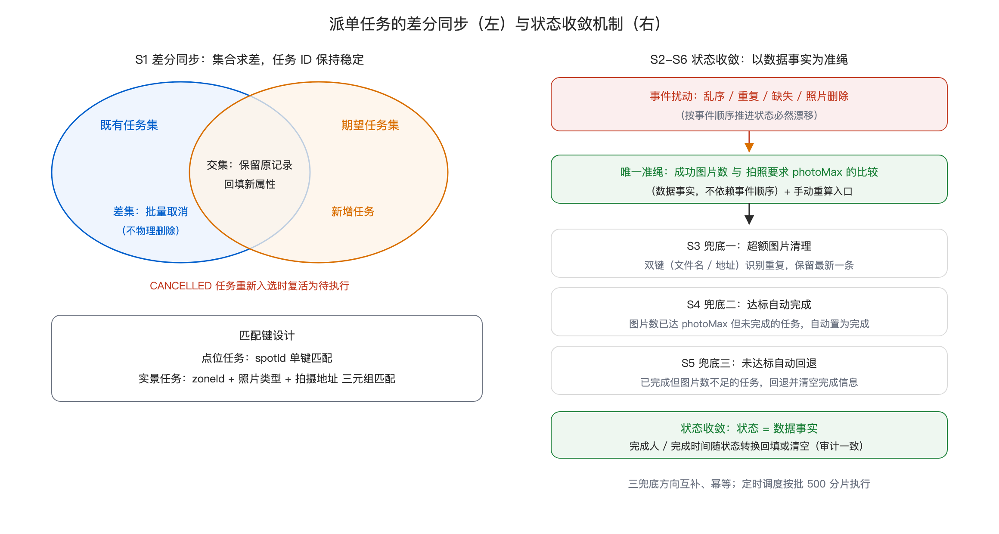

> 这是一份任务一致性方法的说明，范围限定在媒体投放现场作业场景下的点位任务与实景任务。文中方法名与步骤号对应一套已落地的实现，业务主体、客户与部署信息均已略去；讨论的是任务集合的维护与状态判定，不涉及现场人员的排班与考核。

先把结论放在前面：**任务状态不该由事件顺序决定，应该由数据事实决定；任务集合不该在范围变更时全量重建，应该做集合求差**。三点判断放在开头：1）全删重建的代价不是性能，是已有任务上的照片关联、完成进度与执行人分配全部丢失，现场不返工是硬约束；2）上传成功、删除照片、人工标记这类事件在分布式场景下必然乱序、重复或缺失，按事件推进的状态机把这些扰动原样固化进状态；3）以「成功图片数与拍照要求」为准绳后，状态收敛不需要追踪事件历史，三个方向互补的定时兜底即可覆盖全部偏差方向。

## 一、全量重建与状态漂移两类缺陷

### 1、全量重建丢失的是业务资产

派单的点位范围发生增删时，常见实现是删除该派单全部任务再重新生成。删除动作本身很快，代价在别处：任务记录上挂着的照片关联、完成进度、执行人分配随记录一起消失，进行中的任务被误删后现场人员的已完成工作量作废。<u>以事件顺序推进状态的系统通常把状态变化记成事件序列</u>[5]，全量重建等于把这段序列连同它指向的实体一起抹掉，恢复不出来。

### 2、状态漂移的三种扰动

| 扰动 | 触发场景 | 漂移结果 | 按事件顺序推进时的表现 |
|---|---|---|---|
| 乱序 | 并发上传、网络重排 | 达标但状态未完成 | 完成事件早于最后一张图片事件到达 |
| 重复 | 同一照片多次上传 | 图片数超额、状态虚高 | 每个上传事件各推进一次 |
| 缺失 | 事件丢失、照片删除、判不合格 | 状态已完成但图片不足 | 已完成状态无后续事件回退 |

<u>最终一致并不意味着状态会自动正确，它意味着系统在无新输入后会收敛到一个值</u>[1]；<u>一致性、可用性与分区容忍的取舍证明说明分布式环境下无法靠强一致的事务消除这类偏差</u>[2]。若收敛的目标值由事件顺序决定，收敛的只是错误状态，因此必须先把判定依据从事件换成数据事实。

### 3、判据

评估方案的判据是：1）变更前后任务 ID 保持稳定，照片关联与进度不丢失；2）状态与数据事实一致，且与事件到达顺序无关；3）兜底逻辑幂等，重复执行不改变结果；4）批量处理不产生长事务与超长 SQL。下文六步方案逐条对应。

## 二、集合求差式差分同步

### 1、求差三分支

派单点位范围变更时，先按新点位集合重新生成期望任务集，再计算既有任务集与期望任务集的差集与交集：交集任务保留原记录并回填新属性；已取消状态的任务在重新入选时复活为待执行；差集中的任务批量取消而非物理删除。三分支的语义如下。

| 分支 | 集合关系 | 动作 | 保留的内容 |
|---|---|---|---|
| 交集 | 既有 ∩ 期望 | 保留原记录、回填新属性 | 任务 ID、照片关联、进度、执行人 |
| 期望独有 | 期望 − 既有 | 新建任务 | 无历史，按新属性初始化 |
| 既有独有 | 既有 − 期望 | 批量取消（不物理删除） | 历史可追溯，复活时沿用 |

取消而非删除是刻意选择：物理删除会让历史照片失去挂载点，也让「该点位曾被派过」这条事实无法审计；批量取消保留记录，重新入选时直接从取消态复活，不必新建。

### 2、双匹配键

差分的前提是「同一任务在变更前后能被认出来」。点位任务按点位标识（spotId）单键匹配；实景任务按「小区标识 + 照片类型 + 拍摄地址」三元组匹配。实景任务不能用单键，是因为同一小区内不同照片类型、不同拍摄地址对应不同任务，单键会把它们错误合并成一条，求差结果随之失真。

图 1 左半给出三个集合分支与复活规则，右半给出状态收敛闭环：事件扰动不改变判定依据，准绳是数据事实，三个兜底方向互补。

## 三、以数据事实为准绳的状态收敛

### 1、唯一准绳与手动重算

任务状态的判定依据统一为数据事实：任务名下成功上传图片数与任务拍照要求 `photoMax` 的比较关系，而非上传、删除、标记等事件的先后顺序。提供手动触发重算入口，对指定任务批量按准绳重算状态。手动重算与定时兜底共用同一段重算逻辑，避免「手动一条路、定时另一条路」形成两套口径。

### 2、三个方向互补的定时兜底

| 兜底 | 扫描对象 | 动作 | 修正的偏差方向 |
|---|---|---|---|
| 超额图片清理 | 图片数超过拍照要求的任务 | 按文件名或图片地址双键的或逻辑识别重复上传，保留最新一条，清理其余后重算 | 输入侧重复 |
| 达标自动完成 | 图片数已达 `photoMax` 但状态未完成 | 自动置为完成，完成人与完成时间取最后一次成功上传的对应信息 | 该完成未完成 |
| 未达标自动回退 | 状态已完成但图片数不足 | 自动回退为未完成，清空完成人与完成时间 | 不该完成却完成 |

三个方向覆盖的是偏差的全部符号：清理治理输入侧，自动完成向上修正，自动回退向下修正。完成人与完成时间的回填、清空与状态转换绑定，避免「状态回退但操作人残留」这种审计不一致。兜底逻辑幂等，<u>同一批任务重复执行结果一致，与幂等请求在重复投递下保持单次效果的性质相同</u>[3]。

### 3、收敛闭环

事件扰动（乱序、重复、缺失、照片删除）不再直接改状态，只改数据事实；状态由准绳重算或从三个方向兜底逼近准绳。手动重算提供即时收敛，定时任务提供周期收敛，两者叠加后系统在无新输入时收敛到「状态 = 数据事实」。这个结构不需要事件溯源、不需要分布式事务，也不需要保证事件恰好一次到达。

## 四、分片、幂等与机制边界

### 1、批量分片

兜底任务按批处理（如每批 500 个任务），避免按长 ID 列表查询导致的 SQL 长度与性能问题。<u>Spring Batch 的面向块处理把大批量拆成可重复的小事务单元</u>[4]，本方案的批次划分取同一思路：批内重算幂等，批间互不依赖，失败批次单独重试不影响其余批次。

### 2、三条可验证的技术效果

1）派单点位变更后，进行中任务的照片关联与进度全部保留，现场作业不返工；2）任务状态在兜底周期内收敛到与数据事实一致，即使经历事件乱序、重复上传与照片删除；3）兜底重复执行结果一致，分批执行避免长事务与长 SQL。三条效果分别对应任务集合、状态正确性、执行可靠性。

### 3、边界与变体

匹配键可扩展为模糊匹配以关联同点位换编号的历史任务；准绳可扩展为多条件（图片数 + 审核结论 + 水印校验）；机制可推广到同构的「数据事实 vs 状态」一致性场景，如工单完成条件与库存占用。方案不解决照片内容本身的真实性判定，也不覆盖任务分配与人员权限——那属于取证与权限两条独立链路，不在本文范围内。

## 收束

这套方法把两件事分开：任务集合用求差维护，保证 ID 与历史资产稳定；任务状态用数据事实判定，保证与事件顺序无关。集合求差的关键在双匹配键，状态收敛的关键在三个兜底方向的互补——只做「达标自动完成」而不做「未达标回退」，照片被删除后状态就永久停在错误的完成态。两处都不依赖分布式事务，靠幂等与分片把成本压在可控范围。

## 参考文献

1. Vogels, W. (2008) Eventually Consistent（最终一致的含义：无新输入后系统收敛到一个值）. https://www.allthingsdistributed.com/2008/12/eventually_consistent.html
2. Gilbert, S. & Lynch, N. (2002) Brewer's Conjecture and the Feasibility of Consistent, Available, Partition-Tolerant Web Services（CAP 取舍的形式化证明）. https://www.comp.nus.edu.sg/~gilbert/pubs/BrewersConjecture-SigAct.pdf
3. Stripe API Reference · Idempotent Requests（重复请求下保持单次效果的幂等设计）. https://docs.stripe.com/api/idempotent_requests
4. Spring Batch Reference Documentation · Chunk-oriented Processing（把大批量拆成小事务单元的面向块处理）. https://docs.spring.io/spring-batch/reference/step/chunk-oriented-processing.html
5. Fowler, M. · Event Sourcing（以事件序列记录状态变化的系统形态）. https://martinfowler.com/eaaDev/EventSourcing.html
