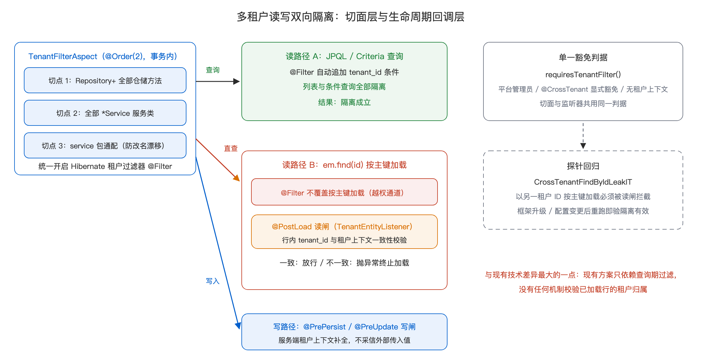

> This is an isolation-mechanism note, scoped to ORM-based multi-tenant systems with shared schemas and shared applications. Component names and step numbers correspond to a working implementation; organization, customer, and deployment details are omitted. The subject is framework-level mechanism, not conventions such as "remember to add the tenant condition in business code."

The conclusion first: **multi-tenant isolation that relies solely on ORM query filters is incomplete, and the gap is not in how queries are written — it is the primary-key load path that never passes through the filter.** The repair is not another business-layer condition but a read gate pushed down into persistence lifecycle callbacks: every entity row entering the persistence context has its tenant ownership checked once at `@PostLoad`, and a mismatch terminates the load. Three judgments up front: 1) if filter activation matches annotations or class names, renames and package moves silently disable isolation, so drift must be eliminated mechanically; 2) wrong aspect ordering disables the whole mechanism — filter activation requires an active transaction and persistence context; 3) the write side must trust only server-side tenant context, never a caller-supplied tenant identifier.

## 1. Three @Filter Defects and the Leak Probe

### 1. Defect one: primary-key loads bypass the filter

The mainstream approach adds a `tenant_id` column to shared tables and lets an ORM filter append the tenant condition to queries. <u>Hibernate's `@Filter` defines an enableable, parameterized query filter applied to entity queries</u>[1]. A direct primary-key load such as `em.find(id)` does not travel through JPQL / Criteria queries, so the filter does not apply. The consequence: list endpoints are fully isolated while a detail endpoint can read another tenant's row by ID. <u>OWASP lists accessing another party's data by object identifier as API1:2023 Broken Object Level Authorization</u>[5]; what is special here is that the defect comes from a framework mechanism's coverage boundary, not from a forgotten business check.

An integration-test probe reproduced the behavior: loading a row belonging to tenant B by primary key as tenant A returned nothing through list queries but succeeded through direct load. That probe later became the regression criterion for the read gate. This is a common behavioral vulnerability of every query-time-filter scheme, not a mistake in one codebase.

### 2. Defects two and three: activation drift and wrong-side writes

| Defect | Trigger | Symptom | Blind spot in common practice |
|---|---|---|---|
| Activation-point drift | New service class, class rename, package move | Filter never enabled; isolation fails silently | Annotation- or class-name-matched pointcuts cannot cover new shapes |
| Missing tenant on write | New row written without `tenant_id` | Row with no tenant ownership | Relies on per-call assignment in business code |
| Forged tenant on write | Caller-supplied `tenant_id` written directly | Cross-tenant write | Caller argument never corrected at framework layer |

All three depend on business code being written correctly, with no framework-level guarantee. Taken together with the primary-key leak, the conclusion is that the read side, the pointcut side, and the write side each need a mechanism, and all three must share one tenant-context predicate; otherwise exemption logics contradict each other.

### 3. Criterion: mechanical guarantee, not probabilistic convention

Three criteria: 1) the filter is necessarily enabled for any component in the service package, regardless of name or sub-package; 2) every row entering the persistence context necessarily has its tenant ownership checked; 3) every written row's tenant identifier is necessarily determined by server-side context.

## 2. Three Pointcuts and Transaction-Internal Ordering

### 1. Three execution pointcuts

One aspect activates the tenant filter from three signature-matched pointcuts.

| Pointcut | Coverage | Problem solved |
|---|---|---|
| `execution(* org.springframework.data.repository.Repository+.*(..))` | All repository methods | <u>Spring Data repositories are dynamic proxies; annotation-matched aspects may not match on the proxy, while a signature-matched execution pointcut always fires</u>[4] |
| `execution(* ..*Service.*(..))` | All service classes | Covers conventional service-layer calls |
| `execution(* ..service..*.*(..))` | Every component in the service package | Isolation survives non-`*Service` naming and later renames |

The third pointcut is the key: it turns "filter activation drifting with code shape" from a probabilistic problem into a mechanical impossibility. The cost is that pointcuts may hit shared components that should not carry a tenant condition; those are handled by the single exemption predicate in the next section, not by evading the pointcut.

### 2. @Order(2) relative to the transaction interceptor

<u>Spring's `@Order` determines the execution order of multiple aspects at the same join point, and wrong ordering changes the nesting of around-advice</u>[3]. This aspect sits inside the transaction interceptor: activating the filter requires an active persistence context, and Hibernate yields no session without an active transaction, in which case activation silently passes through. Placed outside the transaction, the entire isolation mechanism fails silently with no error. There is no observable intermediate state here — it is a hidden dependency that must be pinned at design time and guarded by the regression probe.

### 3. Single exemption predicate

Platform administrators, methods explicitly annotated `@CrossTenant`, and public calls with no tenant context are collapsed into one predicate, `requiresTenantFilter()`, shared by the aspect and the entity listener. Exemption logic written in several places commonly produces "query side exempted, read gate not" or the reverse, surfacing at runtime as legitimate calls blocked or unauthorized calls allowed. One predicate lets the whole isolation model be reasoned about in a single pass.

## 3. Read and Write Gates and the Overall Structure

### 1. Write gate: @PrePersist and @PreUpdate

<u>The Jakarta Persistence specification defines entity lifecycle callbacks: `@PrePersist`, `@PreUpdate`, and `@PostLoad` fire before insert, before update, and after load respectively</u>[2]. The write gate writes server-side tenant context into `tenant_id` before insert and update, only for a real tenant context — platform-level rows carry no tenant identifier. A caller-supplied tenant identifier is overwritten at this point and never used as the write source.

### 2. Read gate: @PostLoad

The same listener checks after load that the row's `tenant_id` matches current tenant context, throwing to terminate the load on mismatch. This closes exactly the `em.find` primary-key channel: the filter cannot reach that path, but every row loaded into the persistence context necessarily passes through `@PostLoad`. The difference from existing schemes is not "one more check" but the location of the check — query-time filtering appends a condition at the SQL layer and never validates rows already in memory; a lifecycle callback validates the result itself, independent of how it was loaded.

Figure 1 shows the structure: the aspect layer with three pointcuts activates the filter; read path A is protected by the filter; read path B (primary-key load) bypasses it and is blocked by the `@PostLoad` read gate; the write path is filled by the write gate; the probe verifies isolation continuously.

### 3. Layer correspondence

| Layer | Component | Trigger | Action | Depends on |
|---|---|---|---|---|
| Pointcut layer | Unified aspect (three pointcuts) | Before method invocation | Enable tenant filter | Ordering inside transaction |
| Query layer | ORM filter | JPQL / Criteria execution | Append `tenant_id` condition | Filter enabled |
| Read gate | `@PostLoad` listener | After entity load | Validate row tenant ownership | Single exemption predicate |
| Write gate | `@PrePersist` / `@PreUpdate` listener | Before insert / update | Write server-side tenant context | Single exemption predicate |

The three layers have non-overlapping scope: pointcuts guarantee activation, queries narrow result sets, and the read/write gates validate or complete the results themselves. No single layer covers all paths, which is why they are combined into one method.

## 4. Probe Regression and Boundaries

### 1. Probe regression

An integration-test probe that loads another tenant's row by primary key is the acceptance tool for this mechanism: with the read gate active the load terminates; without it the row returns. Re-run the probe after ORM upgrades, transaction configuration changes, or pointcut expression edits to verify the leak channel is still sealed. Turning "is isolation effective" into a repeatable test rather than a one-time review conclusion is the only reliable way to maintain a hidden dependency of this kind.

### 2. Four verifiable effects

1) List and detail isolation agree — direct ID access to another tenant's data is blocked by the read gate; 2) any component in the service package is protected regardless of naming, so pointcut drift no longer causes silent failure; 3) the write side has neither missing nor forged tenant identifiers; 4) isolation effectiveness is regression-verifiable. The four map to read, pointcut, write, and verification.

### 3. Boundaries and variants

The read gate extends to row-level validation interceptors for asynchronous batch loads; the predicate extends to two-level composite tenants such as group and subsidiary; the scheme is ORM-independent, since equivalent lifecycle callbacks or an interceptor plus post-row processing can substitute. It does not cover direct database connections, batch jobs bypassing the application, or backup-and-restore paths — those never pass through a persistence context and belong to a different security boundary, outside this note's scope.

## Closing

The point most worth singling out is turning `@PostLoad` from "something you can do after an entity loads" into a multi-tenant read gate: query-time filters govern what is queried, lifecycle callbacks govern whether the rows that actually arrived belong to this tenant. The scopes differ and neither is sufficient alone. Three pointcuts eliminate activation drift, the write gate unifies tenant context, one exemption predicate and an integration-test probe keep the model coherent and verifiable, and isolation shifts from business-code discipline to a framework-level mechanical guarantee. The cost is a maintained exemption list for shared components hit by the broad pointcut; the return is consistent list/detail semantics that remain verifiable after upgrades.

## References

1. Hibernate ORM 6.6 User Guide (`@Filter` definition, parameterized filter conditions, application to entity queries). https://docs.jboss.org/hibernate/orm/6.6/userguide/html_single/Hibernate_User_Guide.html
2. Jakarta Persistence 3.1 Specification (lifecycle callback timing for `@PrePersist` / `@PreUpdate` / `@PostLoad`). https://jakarta.ee/specifications/persistence/3.1/jakarta-persistence-spec-3.1.html
3. Spring Framework Reference · Advice Ordering (`@Order` controlling aspect execution order at a join point). https://docs.spring.io/spring-framework/reference/core/aop/ataspectj/advice.html
4. Spring Data JPA Reference Documentation (Repository dynamic proxies and query execution). https://docs.spring.io/spring-data/jpa/docs/current/reference/html/
5. OWASP API Security Top 10 2023 · API1:2023 Broken Object Level Authorization (accessing another party's data by object identifier). https://owasp.org/API-Security/editions/2023/en/0xa1-broken-object-level-authorization/
