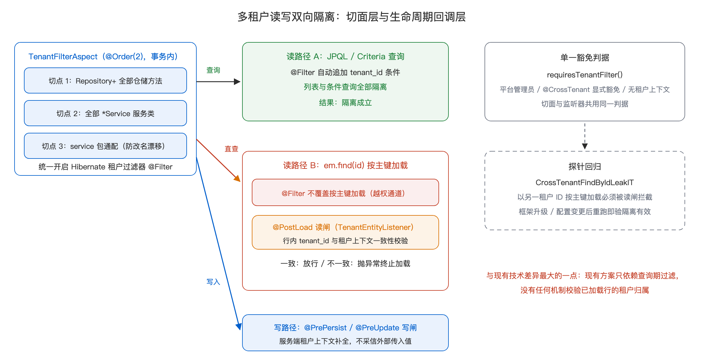

> 这是一份隔离机制的说明，范围限定在共享库表、共享应用的 ORM 多租户系统。文中组件名与步骤号对应一套已落地的实现，业务主体、客户与部署信息均已略去；讨论的对象是框架层机制，不是业务代码里「记得加租户条件」这类约定。

先把结论放在前面：**只依赖 ORM 查询过滤器的多租户隔离是不完整的，缺口不在查询写法，而在按主键加载这条不经过过滤器的路径**。修补方式不是在业务层补查询条件，而是把读闸下沉到持久化生命周期回调：任何进入持久化上下文的实体行，其租户归属在 `@PostLoad` 阶段被校验一次，与当前租户上下文不一致即终止加载。三点判断放在开头：1）过滤器开启点若按注解或类名匹配，代码改名与包迁移会让隔离静默失效，必须用机制消除漂移；2）切面次序错了整个机制失效——开启过滤器时必须有活动事务与持久化上下文；3）写侧必须只认服务端租户上下文，不采信调用方传入的租户标识。

## 一、@Filter 的三个缺陷与越权探针

### 1、缺陷一：按主键加载不经过过滤器

共享库表中增加 `tenant_id` 字段、由 ORM 过滤器为查询自动追加租户条件，是主流做法。<u>Hibernate 的 `@Filter` 定义的是可启用的、带参数的查询过滤条件，作用于实体查询</u>[1]；`em.find(id)` 这类按主键直接加载不走 JPQL / Criteria 查询路径，过滤器对它不生效。后果是列表接口全部隔离、详情接口可以凭 ID 跨租户读取——<u>OWASP API1:2023 把凭对象标识访问他人数据列为对象级授权缺陷</u>[5]，这里的特殊之处在于缺陷不来自业务忘记鉴权，而来自框架机制的覆盖边界。

实施中以集成测试探针复现过这个行为：以租户 A 的身份按主键加载租户 B 的记录，列表查询查不到、直接加载能返回。探针随后成为读闸是否生效的回归判据。这是所有基于查询期过滤器的多租户方案的共性行为漏洞，不是某一套代码写错。

### 2、缺陷二与缺陷三：开启点漂移、写侧漏填误填

| 缺陷 | 触发条件 | 表现 | 现有做法的盲区 |
|---|---|---|---|
| 过滤器开启点漂移 | 新增服务类、类改名、包迁移 | 过滤器未开启，隔离失效且无报错 | 切点按注解或类名匹配时无法覆盖新形态 |
| 写侧漏填 | 新增记录未写 tenant_id | 数据落入无租户归属的行 | 依赖业务代码逐个赋值 |
| 写侧误填 | 直接采信调用方传入的 tenant_id | 跨租户写入 | 调用方参数未经框架层校正 |

三者的共同点是都依赖「业务代码写对」，而框架层没有任何机制保证写对。把这三个缺陷与按主键越权放在一起看，结论是：读侧、切点侧、写侧需要三块机制，且必须共用同一套租户上下文判据，否则各处豁免逻辑会互相矛盾。

### 3、判据：机制性保证而非概率性约定

评估隔离方案的判据是：1）服务包内任何组件，无论命名与所在子包，过滤器必然开启；2）任何进入持久化上下文的行，其租户归属必然被校验；3）任何写出的行，租户标识必然由服务端上下文决定。下文六步方案逐条对应。

## 二、三重切点与事务内次序

### 1、三重 execution 切点

统一切面以三个签名匹配的切点开启租户过滤器，覆盖关系如下。

| 切点 | 匹配范围 | 解决的问题 |
|---|---|---|
| `execution(* org.springframework.data.repository.Repository+.*(..))` | 全部仓储方法 | <u>Spring Data 的 Repository 是动态代理，注解式切面在代理上可能不匹配，签名匹配的 execution 切点必然触发</u>[4] |
| `execution(* ..*Service.*(..))` | 全部服务类 | 覆盖常规服务层调用 |
| `execution(* ..service..*.*(..))` | service 包内全部组件 | 类名不符合 `*Service` 约定或后续改名时仍开启 |

第三个切点是关键：它把「过滤器开启点随代码形态漂移」从概率性问题变成机制上不可能。代价是切点可能命中不该加租户条件的公共组件，这部分由下一节的单一豁免判据统一处理，而不是靠绕过切点。

### 2、@Order(2) 与事务拦截器的相对位置

<u>Spring 的 `@Order` 决定同一连接点上多个切面的执行次序，次序错误会改变环绕通知的嵌套关系</u>[3]。本方案把切面置于事务拦截器内侧：开启过滤器需要先取得活动的持久化上下文，而 Hibernate 在无活动事务时取不到会话会直接放行，次序一旦放到事务外，整个隔离机制静默失效且不报错。这一步没有可观测的中间状态，属于必须在设计阶段钉死、并靠探针回归兜住的隐性依赖。

### 3、单一豁免判据

平台管理员、显式标注 `@CrossTenant` 的跨租户方法、无租户上下文的公共调用，这三类豁免收敛到一个判据 `requiresTenantFilter()`，切面与实体监听器共用它。多处各写豁免逻辑的常见后果是「查询侧豁免了、读闸没豁免」或反过来，运行时表现为合法调用被误拦或越权调用被放行；单一判据让整个隔离模型可以一次推理清楚。

## 三、读写双向闸与整体结构

### 1、写闸：@PrePersist 与 @PreUpdate

<u>Jakarta Persistence 规范定义了实体生命周期回调，`@PrePersist`、`@PreUpdate`、`@PostLoad` 分别在插入前、更新前与加载后触发</u>[2]。写闸在插入与更新前把服务端租户上下文写入 `tenant_id`，仅对真实租户上下文生效，平台级数据不写租户标识；调用方传入的租户标识在此被覆盖，不作为写入依据。

### 2、读闸：@PostLoad

同一监听器在加载后校验实体行内的 `tenant_id` 与当前租户上下文一致，不一致即抛异常终止加载。这一步封堵的正是 `em.find` 的按主键越权通道：过滤器管不到这条路径，但任何被加载进持久化上下文的行都必然经过 `@PostLoad`。与现有方案的差异不在「多一道校验」，而在校验的位置——查询期过滤只在 SQL 层追加条件，不校验已经进入内存的行；生命周期回调校验的是结果本身，与加载方式无关。

图 1 给出整体结构：左侧切面层三重切点统一开启过滤器，右上读路径 A 由过滤器保障，右中读路径 B（按主键加载）绕过过滤器后由 `@PostLoad` 读闸拦截，底部写路径由写闸补全，右侧探针持续验证。

### 3、读写闸与豁免判据的对应关系

| 层 | 组件 | 触发时机 | 动作 | 依赖 |
|---|---|---|---|---|
| 切点层 | 统一切面（三个切点） | 方法调用前 | 开启租户过滤器 | 事务内次序 |
| 查询层 | ORM 过滤器 | JPQL / Criteria 执行时 | 追加 tenant_id 条件 | 过滤器已开启 |
| 读闸 | 实体监听器 `@PostLoad` | 实体加载后 | 校验行内租户归属 | 单一豁免判据 |
| 写闸 | 实体监听器 `@PrePersist` / `@PreUpdate` | 插入、更新前 | 写入服务端租户上下文 | 单一豁免判据 |

三层的作用域不重叠：切点层保证开启、查询层缩小结果集、读写闸校验与补全结果本身。任何一层单独成立都不足以覆盖全部路径，这正是把它们组合成一套方法的理由。

## 四、探针回归与机制边界

### 1、探针回归

按主键跨租户加载的集成测试探针是这套机制的验收工具：探针以另一租户的标识按主键加载，读闸生效时加载被终止，读闸缺失时返回记录。ORM 框架升级、事务配置调整、切点表达式修改之后重跑探针，即可验证越权通道仍被封堵。把「隔离是否有效」变成一条可重复执行的测试，而不是一次性的代码审查结论，是这类隐性依赖唯一可靠的维护方式。

### 2、四条可验证的技术效果

1）列表隔离与详情隔离一致，按 ID 直查其他租户数据被读闸拦截；2）service 包内任何组件无论命名如何均受保护，切点漂移不再导致静默失效；3）写侧无漏填、无误填，租户标识由框架写入；4）隔离有效性可回归验证。四条效果分别对应读、切点、写、验证四个维度。

### 3、边界与变体

读闸可扩展为异步批量加载场景的行级校验拦截器；判据可扩展支持集团与子公司两级复合租户；方案不依赖特定 ORM，同类生命周期回调或拦截器加行后处理可以等价替换。方案不覆盖数据库直连、绕过应用的批处理与备份恢复链路——那些路径根本不经过持久化上下文，属于另一层的安全边界，不在本文范围内。

## 收束

这套方法最值得单列的一点，是把 `@PostLoad` 从「实体加载后可以做点什么」变成多租户的读闸：查询期过滤器管的是「查什么」，生命周期回调管的是「加载进来的行是不是本租户的」，两者作用域不同，缺一不可。配合三重切点消除开启点漂移、写闸统一租户上下文、单一豁免判据与集成测试探针，隔离从依赖业务代码自觉变成框架层机制性保证。代价是切点会多命中一些公共组件，需要维护一份豁免清单；换来的是列表与详情口径一致、升级后仍可验证。

## 参考文献

1. Hibernate ORM 6.6 User Guide（`@Filter` 的定义、参数化过滤条件及其作用于实体查询的机制）. https://docs.jboss.org/hibernate/orm/6.6/userguide/html_single/Hibernate_User_Guide.html
2. Jakarta Persistence 3.1 Specification（实体生命周期回调 `@PrePersist` / `@PreUpdate` / `@PostLoad` 的触发时机）. https://jakarta.ee/specifications/persistence/3.1/jakarta-persistence-spec-3.1.html
3. Spring Framework Reference · Advice Ordering（`@Order` 对同一连接点上切面执行次序的控制）. https://docs.spring.io/spring-framework/reference/core/aop/ataspectj/advice.html
4. Spring Data JPA Reference Documentation（Repository 动态代理与查询执行机制）. https://docs.spring.io/spring-data/jpa/docs/current/reference/html/
5. OWASP API Security Top 10 2023 · API1:2023 Broken Object Level Authorization（凭对象标识访问他人数据的风险）. https://owasp.org/API-Security/editions/2023/en/0xa1-broken-object-level-authorization/
